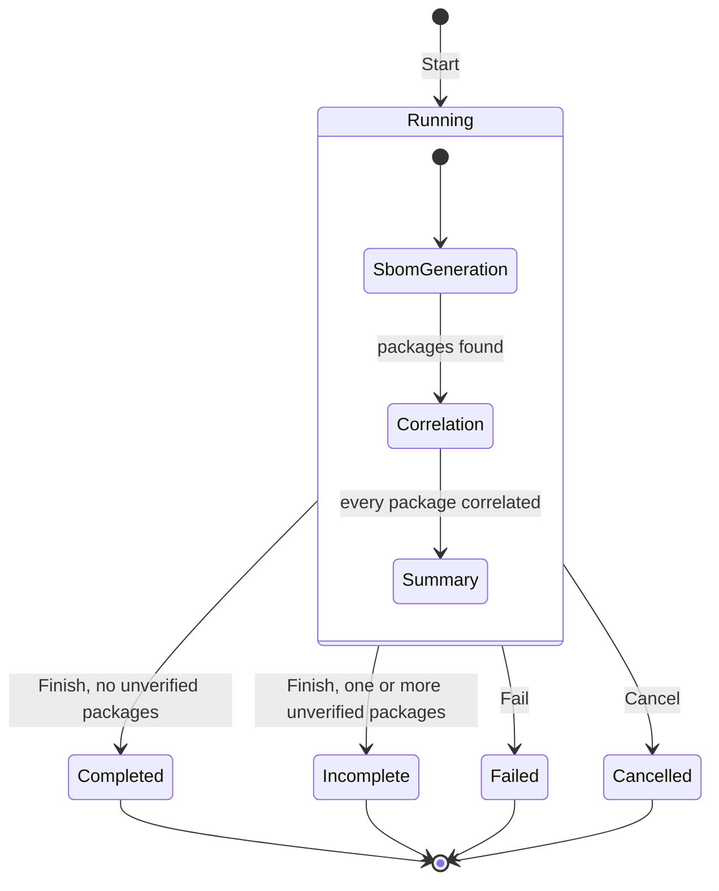
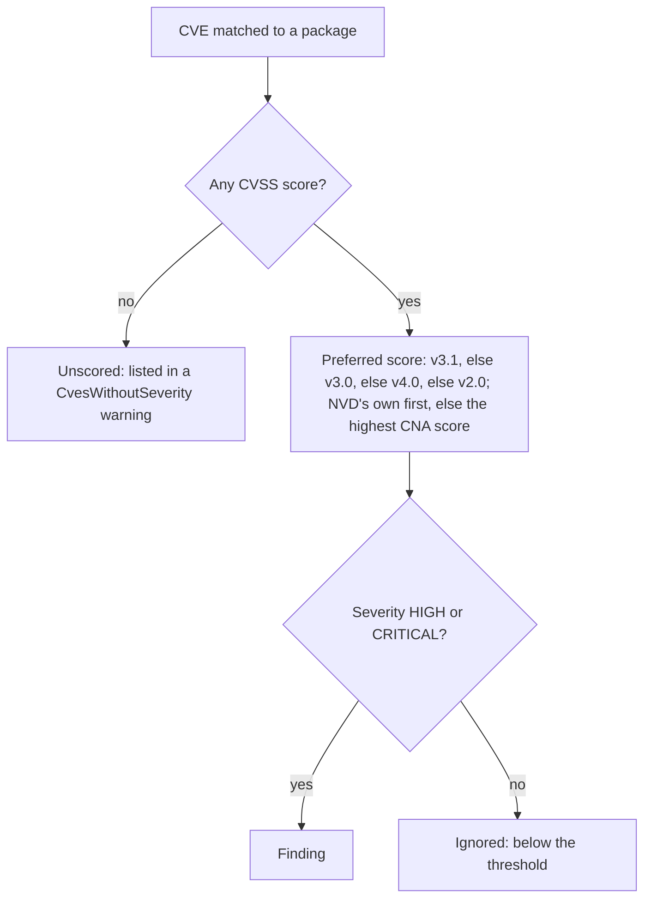

# U1 Domain — Business Logic Model

**Stage**: CONSTRUCTION — U1 Domain — Functional Design (Standard depth)

The Domain runs no workflow of its own. The Application pipeline (U2) drives a `Scan` through its transitions and
calls the domain rules to turn Syft packages and NVD records into results. This document shows those two pieces —
the scan's state machine and how a matched CVE becomes a finding — with worked examples taken from the S0 data.

## Scan state machine (BR-14)

Text alternative: `Start` creates a Running scan in the SbomGeneration phase. While running, the phase moves forward
only — SbomGeneration, then Correlation, then Summary. From Running, `Finish` ends the scan as Completed (no
unverified packages) or Incomplete (one or more), `Fail` ends it as Failed and `Cancel` as Cancelled. The four final
statuses accept no further transitions. `Finish` is allowed from any phase, so a scan whose SBOM is empty can finish
without correlating anything.

## From a matched CVE to a finding (BR-01 to BR-07)

Text alternative: for each CVE matched to a package, a CVE without any CVSS score is listed in a CvesWithoutSeverity
warning. Otherwise its preferred score is chosen (v3.1, else v3.0, else v4.0, else v2.0; NVD's own score first,
otherwise the highest CNA score). If that score's severity is HIGH or CRITICAL the CVE is a finding; otherwise it is
ignored. A package with at least one finding is vulnerable; its Risk is its highest finding severity.

## Worked examples

### Preferred score (BR-01 to BR-04) — real NVD data from S0

| CVE | Scores NVD returned | Preferred | Finding? |
|---|---|---|---|
| CVE-2023-29530 | v3.1 Primary 6.5 MEDIUM; v3.1 Secondary 7.5 HIGH | 6.5 MEDIUM, v3.1, NVD | No |
| CVE-2018-1000656 | v3.0 Primary 7.5 HIGH; v2.0 Primary 5.0 MEDIUM | 7.5 HIGH, v3.0, NVD | Yes |
| CVE-2026-27205 | v4.0 Secondary 2.3 LOW; v3.1 Primary 4.3 MEDIUM | 4.3 MEDIUM, v3.1, NVD | No |
| CVE-2020-1747 | v3.1 Primary 9.8 CRITICAL; v3.1 Secondary 9.8 CRITICAL; v2.0 Primary 10.0 HIGH | 9.8 CRITICAL, v3.1, NVD | Yes |
| CVE-2025-60876 | none | — | No — listed as unscored (BR-05) |
| Illustrative | v3.1 Secondary 7.5 HIGH; v3.1 Secondary 9.1 CRITICAL; no Primary | 9.1 CRITICAL, v3.1, CNA | Yes (BR-02) |

### Candidate CPE ranking (BR-08) — Syft's candidates from S0

| Package | Syft's order | Order tried (at most three) |
|---|---|---|
| pyyaml 5.3 | 12 generated; `pyyaml:pyyaml` last | `pyyaml:pyyaml`, `python-pyyaml:pyyaml`, `python_pyyaml:pyyaml` |
| log4j-core 2.14.1 | `apache:log4j-core`, `apache:log4j_core`, `apache:log4j` | the same three (the third is NVD's real CPE) |
| requests 2.25.1 | dictionary `python:requests` | `python:requests` |
| flask 0.12.2 | 12 generated, NVD's real CPE absent | `flask:flask`, `python-flask:flask`, `python_flask:flask` — all without records, so a product match follows (U2) |

### Product name (BR-09)

| Package | Product asked about |
|---|---|
| pyyaml (python) | `pyyaml` |
| minimist (npm) | `minimist` |
| github.com/gin-gonic/gin (go-module) | `gin` |
| cloud.google.com/go/auth (go-module) | none — `auth` is generic |
| @angular/core (npm) | none — `core` is generic |
| System.Text.Json (dotnet) | `system.text.json` |
| stdlib (go-module) | none — `stdlib` is generic |
| io (npm) | none — shorter than three characters |

### Versions (BR-10)

| Package | Version reported | Treatment |
|---|---|---|
| syft (binary) | `UNKNOWN` | Not looked up; Unverified, reason `VersionUnknown` |
| cloud.google.com/go/auth (go-module) | `v0.23.3` | Sent to NVD as `0.23.3` |
| busybox (apk) | `1.36.1-r31` | Sent as is |
| left-pad (npm) | `v1.3.0` | Sent as is — only Go modules drop the `v` |

### Identity (BR-11)

| A | B | Same package? |
|---|---|---|
| python `PyYAML` 5.3 | python `pyyaml` 5.3 | Yes — names compared ignoring case |
| python `requests` 2.25.1 | npm `requests` 2.25.1 | No — different types |
| python `requests` 2.25.1 | python `requests` 2.31.0 | No — different versions |

### Summary (BR-13) and highest severity (BR-06)

A scan with 87 packages after merging, of which 2 are vulnerable (3 CRITICAL and 1 HIGH findings between them) and 12
are unverified, has `CleanPackages` = 87 − 2 − 12 = 73, `CriticalFindings` = 3, `HighFindings` = 1, and finishes as
Incomplete. A package whose findings arrive as HIGH then CRITICAL has Risk CRITICAL.

## Rules to tests (U1)

| Rule | Test class | Key cases |
|---|---|---|
| BR-01, BR-02, BR-03 | `CvssScoreSelectionTests` | Every row of the preferred-score table; severity derived from the score when NVD gives none; v2.0 9.3 → HIGH |
| BR-04, BR-05, BR-07 | `FindingSelectionTests` | HIGH and CRITICAL kept, MEDIUM dropped, unscored listed, duplicate CVE ids merged, ordering |
| BR-06 | `VulnerablePackageTests` | HIGH-then-CRITICAL → CRITICAL; at least one finding required |
| BR-08 | `CandidateCpeRankingTests` | Every row of the ranking table; dictionary first; duplicates dropped; cap of three; stable order |
| BR-09 | `ProductNameTests` | Every row of the product-name table |
| BR-10 | `PackageVersionTests` | Every row of the versions table |
| BR-11 | `PackageIdentityTests` | Every row of the identity table; equal packages hash alike |
| BR-12 | `ManifestCatalogTests` | `requirements-dev.txt` and `app.deps.json` are manifests; `app.jar` and `image.tar` are not; case ignored |
| BR-13 | `ScanSummaryTests` | The 87 / 2 / 12 example; counts add up; inconsistent input throws |
| BR-14, BR-15, BR-16 | `ScanStateMachineTests` | Every allowed transition; every disallowed one throws; Completed vs Incomplete; duration; no warnings after the end |
| BR-17, BR-18 | `CveTests`, `UnverifiedPackageTests` | NVD link format; reasons and details |

Story scenarios realized here (per the story map): E05 "The likeliest candidate CPE is tried first", "NVD's own score
wins", "A CVE without any score is listed, not counted" (the selection; U2 adds the warning), "The CVSS version is
chosen and shown"; E06 "Counts add up"; E10 "Risk shows the highest severity", "Cards count findings and packages".
