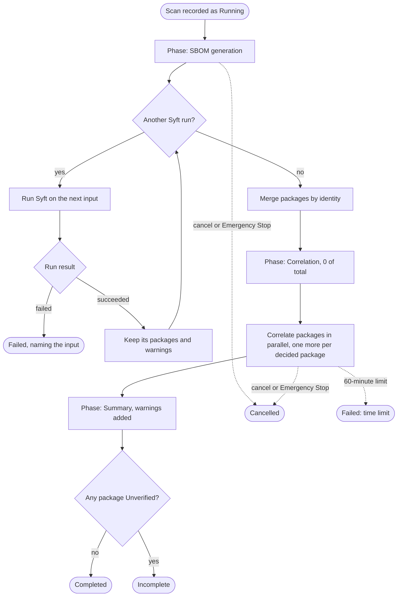
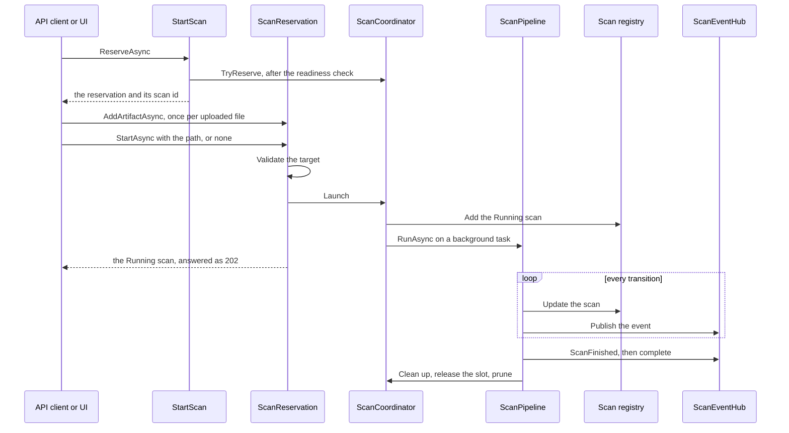
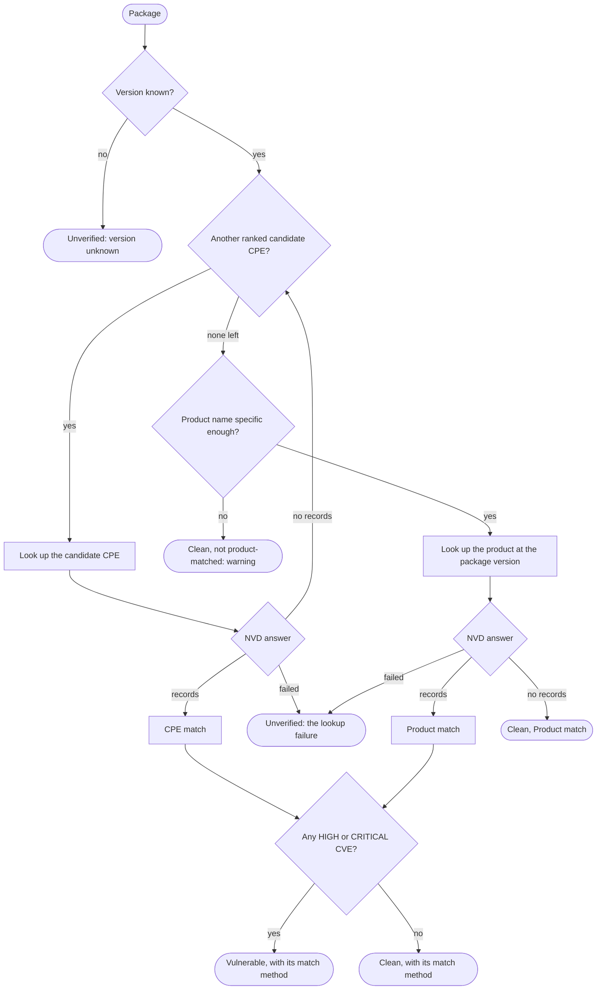

# U2 Application — Business Logic Model

**Stage**: CONSTRUCTION — U2 Application — Functional Design (Comprehensive depth)

How a scan runs from reservation to cleanup, how each package is correlated, what the Live Log says along the way, and
worked examples that become test rows. Rules are cited as AR-nn (`business-rules.md`) and BR-nn (U1). The three diagrams
were validated with Mermaid 11.4.1; each has a text alternative.

## Scan pipeline

Text alternative: a Running scan enters SBOM generation and runs Syft once per input, one run at a time (AR-08). A
failed run fails the scan at once, naming its input (AR-09); a successful run contributes its packages and any
warnings (AR-10, AR-11). After the last run the packages are merged by identity (AR-12), the scan enters correlation at
0 of total, and packages are correlated in parallel, the progress growing by one per decided package (AR-17, AR-22).
In the summary phase the warnings are added (AR-19) and the scan finishes Completed, or Incomplete when any package is
unverified (AR-20). Cancel or Emergency Stop in either working phase ends it Cancelled (AR-27, AR-28); the 60-minute
limit ends it Failed (AR-29). Every ending runs the same cleanup (AR-32).

## From reservation to finish

Text alternative: the client — the API's multipart reader or the UI through it — asks `StartScan` for a reservation.
After checking readiness (AR-01), `StartScan` claims the active slot from `ScanCoordinator` (AR-02) and returns the
reservation with its scan id. The client adds each uploaded file (AR-06, AR-07) and then starts the scan with a path or
without one. The reservation validates the target (AR-04, AR-05) and asks the coordinator to launch it: the coordinator
adds the Running scan to the registry and runs the pipeline on a background task, and the client gets the Running scan
(202 in the API). From then on every transition is written to the registry and then published on the scan's hub
(AR-21). The pipeline ends by publishing `ScanFinished`, completing the hub, and cleaning up (AR-32).

## Package correlation

Text alternative: a package with an unknown version is Unverified without any lookup (AR-13). Otherwise its ranked
candidate CPEs are looked up in turn (AR-14): records make a CPE match, no records move to the next candidate, and a
failed lookup makes the package Unverified with that failure. When no candidate is left — or there were none — the
product stage begins (AR-15): a name too generic to product-match leaves the package clean, listed in the scan's
warning; otherwise the product is looked up at the package's version, where records make a product match, no records
leave it clean with the Product match method, and a failure makes it Unverified. A CPE or product match is vulnerable
when any of its CVEs is HIGH or CRITICAL and clean otherwise (AR-16).

Not drawn: before every lookup, a scan that has declared NVD unavailable makes the package Unverified with "NVD
unavailable" instead (AR-18); and the matched CVEs without a score always go into the package's warning (AR-16).

## Live Log messages

The original's wording is kept where it had a message; the rest follows its style (AR-24). Placeholders are in braces.

| When | Level | Message |
|---|---|---|
| A directory scan starts | Information | 🚀 Initializing vetting sequence for: {path} |
| An upload scan starts | Information | 🚀 Initializing vetting sequence for: uploaded artifacts, then 📥 Processing {n} uploaded artifact(s) |
| A scan is refused | Warning | ❌ Vetting sequence refused: {message} |
| A Syft run starts | Debug | 📑 Generating SBOM for: {input} |
| A run finds packages | Information | 📦 {n} package(s) identified in {input} |
| A run finds none | Warning | ⚠️ No packages identified in {input} |
| A container image is found | Warning | ⚠️ Distribution backports are not considered for {input} |
| A run fails | Error | ❌ Syft failed: {reason} |
| Packages are merged | Information | ⚙️ {n} unique package(s) to vet |
| A CPE is looked up | Debug | 🔍 CPE search: {cpe} |
| A CPE match has findings | Information | 🚩 Found {n} vulnerabilities via CPE for {package} |
| A CPE match has none | Debug | ✅ No vulnerabilities found for this CPE: {cpe} |
| A product is looked up | Debug | 🔍 Product search: '{product}' {version} |
| A product match has findings | Information | 🚩 Found {n} vulnerabilities via product match for {package} |
| A product match has none | Debug | ✅ No vulnerabilities found via product match for {package} |
| A name is too generic | Debug | ⏭ {package}: name too generic for a product match |
| A lookup fails | Warning | ⚠️ NVD CPE Search failed for {cpe}: {reason}, or ⚠️ NVD product search failed for {package}: {reason} |
| A version is unknown | Warning | ⚠️ {package}: version unknown, not checked |
| NVD is declared unavailable | Error | ❌ NVD unavailable: {n} lookups failed in a row; remaining packages not checked |
| A scan finishes | Information | ✅ Vetting sequence complete: {vulnerable} vulnerable, {unverified} unverified, {clean} clean of {total} package(s) |
| A scan fails | Error | ⚠️ Vetting Sequence Aborted: {reason} |
| Emergency Stop | Warning | 🛑 EMERGENCY STOP: Terminating scan {id} |
| A scan is cancelled | Error | 🚨 CRITICAL: Sequence aborted. System resources released. |

The original's own lines in this table are the 🚀, 📥 (for manifests), ❌ Syft failed, 🔍 (keyword search), 🚩 and ✅
(CPE), ⚠️ NVD CPE Search failed, ⚠️ Vetting Sequence Aborted, 🛑 (with a process id) and 🚨 messages.

## Warning messages

| Code | Message |
|---|---|
| `NoPackagesIdentified` | No packages identified in {input} |
| `DistributionBackportsNotConsidered` | Distribution backports are not considered for {input}: versions are checked as the image reports them |
| `NotProductMatched` | Not product-matched, name too generic: {name version}, … and {k} more |
| `CvesWithoutSeverity` | {package version}: {CVE ids} not yet scored by NVD |

## Worked examples

### The original's tests, ported

| Original test | Input | Expected now |
|---|---|---|
| `test_scan_directory_orchestration` | Directory `C:/fake/path`; Syft reports requests 2.25.1 with the candidate `cpe:2.3:a:python-requests:requests:2.25.1`; that CPE returns CVE-2021-28363, rated HIGH in the test data | One Syft run over the path; one NVD lookup, for that CPE; requests 2.25.1 vulnerable with one finding, CPE match; totalPackages 1 |
| `test_scan_directory_fallback_to_keyword` | flask 0.12.2 with the candidate `cpe:2.3:a:wrong-vendor:flask:0.12.2` (no records, S0 N1); the product lookup returns CVE-2018-1000656, 7.5 HIGH, CVSS v3.0 | The CPE is looked up, then one product lookup for `flask` at 0.12.2; flask vulnerable with that finding, **Product match** (the original recorded `NVD-KEYWORD-MATCH`) |

### The `mockData.js` false positives

The original showed requests 2.25.1 with CVE-2023-29530 (Laminas Diactoros) and CVE-2024-36401 (GeoServer), which a
keyword search for "requests 2.25.1" returns (S0 N4). When none of requests' candidate CPEs returns records, the product
stage asks only for CVEs whose configurations name `requests`; NVD answers CVE-2023-32681 and CVE-2026-25645, both MEDIUM
(S0 N12). requests 2.25.1 is clean with the Product match method, and neither false-positive id appears anywhere in the
result (E05; defect 10).

### Correlation, from the S0 data

| Package | Lookups | Result |
|---|---|---|
| pyyaml 5.3 (python) | Twelve guesses; `pyyaml:pyyaml`, ranked first, returns CVE-2020-1747 and CVE-2020-14343, both 9.8 CRITICAL | Vulnerable, CPE match, two findings, Risk CRITICAL |
| flask 2.0.0 (python) | The first candidate returns only MEDIUM CVEs | Clean, CPE match; no product lookup (E05; defect 12) |
| minimist 1.2.5 (npm) | Its only candidate, `minimist:minimist`, has no records; product `minimist` returns CVE-2021-44906, 9.8 CRITICAL | Vulnerable, Product match |
| flask 0.12.2 (python) | The three ranked guesses have no records (NVD's real CPE is `palletsprojects:flask`); product `flask` returns the same four CVEs as that CPE, among them CVE-2018-1000656, 7.5 HIGH | Vulnerable, Product match |
| System.Text.Json 10.0.11 (dotnet) | No candidate CPEs (S0 S11) | Straight to the product stage: `system.text.json` at 10.0.11 |
| cloud.google.com/go/auth v0.23.3 (go-module) | Its candidates have no records; `auth` is too generic (BR-09) | Clean, no match method; named in the `NotProductMatched` warning |
| syft UNKNOWN (binary) | None | Unverified, "version unknown" (AR-13) |
| busybox 1.36.1-r31 (apk) | Its CPE match includes CVE-2025-60876, not yet scored | CVE-2025-60876 is no finding; warning "busybox 1.36.1-r31: CVE-2025-60876 not yet scored by NVD"; the verdict comes from its other CVEs |

### Lookup failures and NVD outages

| Situation | Result |
|---|---|
| pyyaml 5.3's first candidate fails with "NVD returned 503" after its retries | Unverified, "NVD returned 503"; the other candidates and the product stage are not asked (Q-U2-1) |
| 87 packages; 2 vulnerable; NVD answers 503 for 12 others after every retry | 12 Unverified, 73 clean; Incomplete (E06) |
| Lookups fail, fail, then one answers with no records | The count of failures in a row goes back to zero (AR-18) |
| Syft's own binary, 281 packages (S0 S10), NVD down, outage threshold n | After n failures in a row NVD is declared unavailable; lookups in flight finish with their own result; every remaining package is Unverified, "NVD unavailable — not checked after n failed lookups in a row"; `syft` UNKNOWN keeps "version unknown"; the scan finishes Incomplete within minutes instead of failing at 60 |

### Uploads

| Upload | Runs | Result |
|---|---|---|
| `requirements.txt`, `app-image.tar` (an image), `notes.docx` | 1: manifests (`requirements.txt`); 2: `app-image.tar`; 3: `notes.docx` | requests 2.25.1, found by runs 1 and 2, is listed once; warnings "Distribution backports are not considered for app-image.tar: …" and "No packages identified in notes.docx" |
| Two files named `requirements.txt` | One manifests run, each file under its own name | Both are scanned |
| `../../evil.txt` | — | Stored as `evil.txt` inside the staging area (E02; defect 5) |
| 26 files | — | The 26th is refused: "At most 25 files per scan" |
| 2.5 GB in total | — | The upload stops at 2 GiB: "Uploads are limited to 2 GB per scan" |
| `PyYAML-5.3-cp38-cp38-win_amd64.whl`, `Newtonsoft.Json.12.0.1.nupkg` | One run each (U3 stages them as `.zip` and reads the `.nuspec`) | pyyaml 5.3; the NuGet package Newtonsoft.Json 12.0.1 and the assemblies inside it |

### Targets

| Request | `AllowedScanRoots` | Outcome |
|---|---|---|
| No path and no artifacts | — | "Choose a directory or upload at least one artifact" |
| `/uploads/acme-app` and one artifact | — | "Choose a directory or upload artifacts, not both" |
| A path with a control character, or longer than 4,096 characters | — | "Target path is not valid" |
| `uploads/acme-app` | — | "Target path must be absolute" |
| `/uploads/acme-ap`, which does not exist | — | "Target path does not exist" |
| `/uploads/acme-app/requirements.txt` | — | "Target path is a file, not a directory" |
| `/etc` | `/uploads` | "Path is outside the allowed scan roots" |
| `/uploads/link-to-etc`, a symbolic link to `/etc` | `/uploads` | "Path is outside the allowed scan roots" |
| `/uploads2/acme` | `/uploads` | "Path is outside the allowed scan roots" — whole segments are compared |
| `/uploads/acme-app/../acme-app` | `/uploads` | Scanned as `/uploads/acme-app` |
| `/uploads/acme-app` | empty | Scanned |

### Stopping

| Situation | Result |
|---|---|
| Emergency Stop while Syft runs | The Syft process tree ends; the scan is Cancelled ("Emergency Stop"); its staging area is deleted; TERMINATED |
| Emergency Stop at 30 of 87 packages | No further NVD lookups are sent; Cancelled with no partial result |
| Emergency Stop during a 2 GB upload | The upload ends with "Emergency Stop ended the upload before the scan started"; nothing is recorded; the slot is free; TERMINATED with the reserved id |
| Emergency Stop with nothing active | IDLE |
| Cancel a Completed scan | "The scan has already finished" |
| The 60-minute limit | Failed, "Scan exceeded the 60-minute limit"; no partial result |

## Rules to tests (U2)

All in `tests/Airlock.Application.Tests`, against in-memory fakes of every port; no network, no Syft.

| Rules | Test class | Key cases |
|---|---|---|
| AR-01 to AR-03, AR-26 | `StartScanTests` | Each readiness reason and both together; a second reservation refused; an abandoned reservation releases the slot and deletes its staging; slot changes pushed to watchers |
| AR-04 to AR-07 | `ScanTargetTests` | Every row of the targets table; 25 and 26 files; the byte limit mid-stream; hostile and duplicate names |
| AR-08 to AR-12 | `SbomGenerationTests` | Run grouping and order; a failed run stops the later ones; empty-run and image warnings; merge across runs with candidate lists combined |
| AR-13 to AR-17 | `PackageCorrelatorTests` | Every row of the correlation tables; the original's two tests; the `mockData.js` false positives |
| AR-18 | `NvdOutageTests` | The threshold reached; the count reset by an answer; lookups in flight finish; Incomplete |
| AR-19, AR-20 | `ScanResultTests` | Warning order and the "and k more" cut-off; Completed and Incomplete; counts add up |
| AR-21 to AR-25 | `ScanEventStreamTests` | Registry before hub; the progress sequence; snapshot first for running, finished and unknown scans; a slow subscriber; scan-scoped log lines; external text cleaned |
| AR-27 to AR-32 | `StoppingScanTests` | Cancel a running, finished and unknown scan; Emergency Stop of a scan, an upload and nothing; the time limit; shutdown; an unexpected error; cleanup order on every exit |
| AR-33 | `RetentionTests` | 24 hours; 20 scans; a running scan never pruned |
| AR-34 | `RenderScanReportTests` | Each refusal; the file name |
| AR-35 | `GetSystemHealthTests` | ONLINE; each check failing; NVD never called |

Architecture rules 2, 4 and 6 go to `tests/Airlock.Architecture.Tests`, with a positive control each, as in U1.

### Regression tests for the defects U2 owns

| Defect | Regression test |
|---|---|
| 3 — Emergency Stop left the NVD phase running | Stop at 30 of 87: no further lookup is sent |
| 6 — A Syft error was reported as 0 packages, clean | A failed run fails the scan, naming its input |
| 7 — A missing NVD key was reported clean | No key: the reservation is refused with `NotReady` |
| 8 — Any NVD failure was reported clean | A failed lookup makes the package Unverified and the scan Incomplete |
| 10 — Keyword search produced unrelated CVEs | The product match never yields the GeoServer or Laminas CVEs |
| 12 — The fallback ran after a CPE match | A CPE match with only MEDIUM CVEs makes no product lookup |
| 15 — Concurrent scans overwrote each other | A second reservation is refused while one is active |

The other U2 cases the unit plan names — unknown versions, the image-scan warning, the 60-minute limit and
snapshot-first streams — are rows above.
