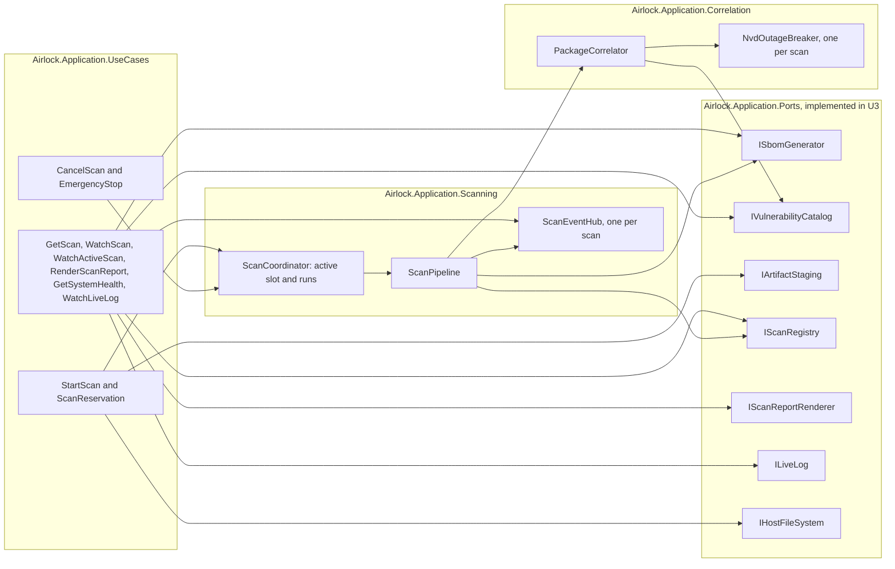

# U2 Application — Logical Components

**Stage**: CONSTRUCTION — U2 Application — NFR Design (Standard depth)

## Namespaces in `Airlock.Application`

| Namespace | Types |
|---|---|
| `Airlock.Application.UseCases` | `StartScan`, `ScanReservation`, `CancelScan`, `EmergencyStop`, `EmergencyStopResult`, `GetScan`, `WatchScan`, `WatchActiveScan`, `RenderScanReport`, `ScanReportDocument`, `GetSystemHealth`, `SystemHealth`, `HealthCheck`, `HealthStatus`, `WatchLiveLog` |
| `Airlock.Application.Outcomes` | `Outcome<T>`, `Outcome` (its factories), `Refusal`, `RefusalCode` |
| `Airlock.Application.Scanning` | `ScanCoordinator`, `ScanPipeline`, `ScanEventHub`, `ArtifactName`; internal `ScanRun`, `StopCause`, `ReservationTicket`, `PackageMerge`, `RetentionPolicy`, `EventQueue` |
| `Airlock.Application.Correlation` | `PackageCorrelator`, `PackageCorrelation`, `CleanCorrelation`, `VulnerableCorrelation`, `UnverifiedCorrelation`, `NvdOutageBreaker` |
| `Airlock.Application.Events` | `ScanEvent`, `ScanSnapshot`, `PhaseChanged`, `PackagesCorrelated`, `ScanLogged`, `ScanFinished`, `LiveLogEntry`, `ActiveScanState` |
| `Airlock.Application.Ports` | `ISbomGenerator` with `SbomSource`, `DirectorySource`, `FileSource`, `SbomPackage`, `SbomOutcome`, `SbomProduced`, `SbomFailed`, `SbomToolStatus`; `IVulnerabilityCatalog` with `CatalogLookup`, `CatalogFound`, `CatalogNoRecords`, `CatalogFailed`; `IArtifactStaging`, `IStagingArea`, `StagedArtifact`, `StagingOutcome`, `ArtifactStaged`, `ArtifactTooLarge`; `IScanReportRenderer`; `IScanRegistry`; `ILiveLog`; `IHostFileSystem` |
| `Airlock.Application.Options` | `AirlockOptions`, `LimitsOptions`, `TimeoutOptions`, `RetentionOptions`, `CorrelationOptions`, `AirlockOptionsValidator` |
| `Airlock.Application.Logging` | `ScanLog` (internal; the source-generated catalogue), `ScanLogScope`, `ScanLogRouter`, `ExternalText` |
| `Airlock.Application` | `ApplicationServiceCollectionExtensions` (`AddAirlockApplication`); internal `ScanLifetimeService` (`IHostedService`) |

## How they connect

Text alternative: the starting use cases claim the slot through `ScanCoordinator`, stage uploads through
`IArtifactStaging` and check directory targets through `IHostFileSystem`. The stopping use cases go through the
coordinator. The reading use cases read the registry and the scan's event hub, render reports through
`IScanReportRenderer`, follow the Live Log through `ILiveLog`, and ask `ISbomGenerator` and `IVulnerabilityCatalog`
whether they are ready. The coordinator starts `ScanPipeline`, which runs Syft through `ISbomGenerator`, correlates
through `PackageCorrelator`, records every version in `IScanRegistry` and publishes on the scan's `ScanEventHub`. The
correlator asks `IVulnerabilityCatalog` and consults the scan's `NvdOutageBreaker` before every lookup. Every port is
implemented in U3.

## Checks introduced in U2

| Check | Project | Enforces |
|---|---|---|
| Architecture rule 2 | `Airlock.Architecture.Tests` | The Application references only `System.*`, `Airlock.Domain` and `Microsoft.Extensions.*`, and depends on no Infrastructure, Web or ASP.NET Core namespace (U2-NFR-01) |
| Architecture rule 4, Application half | `Airlock.Architecture.Tests` | No Application type implements a port interface; U3 adds "implemented in Infrastructure" |
| Architecture rule 6 | `Airlock.Architecture.Tests` | Classes in `Airlock.Application.UseCases` are sealed, and the use cases live there |
| Application clock rule | `Airlock.Architecture.Tests` | No clock reads, timers or untimed delays in Application code (U2-NFR-08) |
| Slot stress test | `Airlock.Application.Tests` | 100 concurrent reservations, one winner, 50 times (U2-NFR-02) |
| Seeded correlation oracle | `Airlock.Application.Tests` | Every verdict matches the decision tables; totals add up (U2-NFR-06) |
| Fault injection | `Airlock.Application.Tests` | A throwing port never yields Completed or Incomplete; cleanup still releases the slot (U2-NFR-06, U2-NFR-11) |
| Never-reading subscriber | `Airlock.Application.Tests` | The scan is not slowed; only droppable events are lost (U2-NFR-07) |
| Log catalogue | `Airlock.Application.Tests` | Messages, levels, event ids and the scan-id scope, on a fake logger (U2-NFR-09) |
| Host modes | `Airlock.Application.Tests` | Target rules in Windows and Linux modes (U2-NFR-12) |
| Options validation | `Airlock.Application.Tests` | Each range in the values table, at both ends |

Each architecture rule has a positive control, as in U1.

## Constraints handed to U3

- One lookup — every attempt, backoff and timeout included — ends within 2 minutes, so the outage breaker meets
  U2-NFR-05.
- The SBOM generator and the catalog honour cancellation promptly (the Syft process-tree kill; cancelled HTTP
  requests), so stopping meets U2-NFR-04's 2 seconds.
- External text is cleaned before it is put into Domain values; `ExternalText` is available to do it.
- The Live Log provider reads the scan id from the `ScanId` scope entry and keeps at most 1,000 lines per subscriber,
  dropping the oldest.
- `IScanRegistry.Update` is atomic for each scan, and `IHostFileSystem` implements all six questions with the host's
  own rules.
