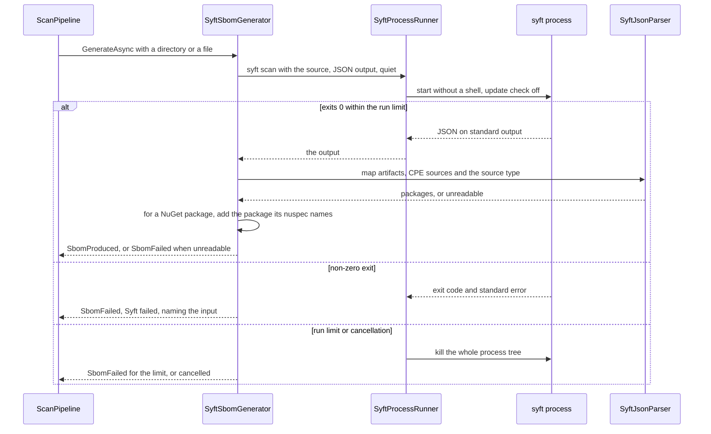
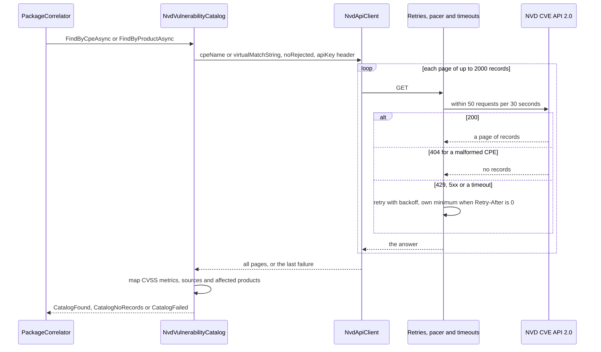

# U3 Infrastructure — Business Logic Model

**Stage**: CONSTRUCTION — U3 Infrastructure — Functional Design (Comprehensive depth)

How a Syft run and an NVD lookup go, the mapping tables, the PDF layout, worked examples from the recorded S0 outputs,
and the rule-to-test map. Rules are IR-nn (`business-rules.md`). Both diagrams were validated with Mermaid 11.4.1; each
has a text alternative.

## A Syft run



Text alternative: the pipeline asks the generator for one run over a directory or a file. The process runner starts
`syft scan` without a shell, with JSON output, quiet, and the update check off (IR-01). If Syft exits 0 within the run
limit, its JSON is mapped into packages, candidate CPEs with their sources, and whether the input was a container image
(IR-03); for a NuGet package the generator also adds the package its `.nuspec` names (IR-04); output that cannot be
read fails the run. A non-zero exit fails the run, naming the input. At the run limit, or when the scan is cancelled,
the runner kills the whole process tree; the run then fails for the limit or ends as cancelled (IR-02).

## An NVD lookup



Text alternative: the correlator asks the catalog for a CPE lookup or a product match. The client sends `cpeName` or
`virtualMatchString` with `noRejected` and the key in the `apiKey` header (IR-07). Each page goes through the client's
retries, the shared pacer and the attempt timeout; a 200 brings a page of records, a 404 for a malformed CPE means no records, and a
429, a 5xx or a timeout is retried with backoff, using its own minimum when `Retry-After` is 0 (IR-08). When every page
has arrived, the catalog maps the records — CVSS metrics with their sources, and the affected products (IR-09) — and
answers found, no records, or failed.

## Mapping tables

### Syft artifact to Package (IR-03)

| Syft | Airlock |
|---|---|
| `type` `python`, `name` `PyYAML`, `version` `5.3` | `Package("python", "PyYAML", "5.3")` |
| `cpes[]` `{cpe: …, source: nvd-cpe-dictionary}` | `CandidateCpe(…, Dictionary)` |
| `cpes[]` `{cpe: …, source: syft-generated}` | `CandidateCpe(…, Generated)` |
| `source.type` `image` | `IsContainerImage` |
| a name with an ESC character, or a 300-character version | the run fails: `SyftOutputUnreadable` (Q-U3-3) |

### NVD metric to CvssScore (IR-09)

| NVD | `CvssScore` |
|---|---|
| `cvssMetricV31[{type: Primary, cvssData: {baseScore: 6.5, baseSeverity: MEDIUM}}]` | 6.5, Medium, v3.1, Primary |
| `cvssMetricV31[{type: Secondary, cvssData: {baseScore: 7.5, baseSeverity: HIGH}}]` | 7.5, High, v3.1, Secondary |
| `cvssMetricV40[{type: Secondary, cvssData: {baseScore: 2.3, baseSeverity: LOW}}]` | 2.3, Low, v4.0, Secondary |
| `cvssMetricV2[{type: Primary, baseSeverity: MEDIUM, cvssData: {baseScore: 5.0}}]` | 5.0, Medium, v2.0, Primary |
| a v3.1 entry without a severity, score 9.8 | 9.8, Critical (derived, BR-03) |
| `ssvcV203` | ignored |

### Process and HTTP outcomes

| Event | Port answer |
|---|---|
| Syft exits 1 with "could not determine source" | `SbomFailed(SyftFailed, "Syft exited with code 1: could not determine source", input)` |
| Syft still running after 15 minutes | `SbomFailed(SyftTimedOut, "Syft did not finish within 15 minutes", input)` |
| NVD 200, `totalResults` 0 | `CatalogNoRecords` |
| NVD 404, header `message: Invalid cpeName parameter` | `CatalogNoRecords` and a warning line |
| NVD 429 `error code: 1015`, `Retry-After: 0`, then 200 | retried after the own minimum backoff; the 200's records |
| NVD 503 on every attempt | `CatalogFailed("NVD returned 503")` |

## The PDF Scan Report (IR-20)

```text
Airlock Scan Report
Scan 0199f0f2-8f62-7c3e-9a51-3d3f5b5c1a2b · /uploads/acme-app · Incomplete
Started 2026-10-22 12:00:00 UTC · Finished 2026-10-22 12:11:42 UTC · Duration 11:42

Summary          Total 87 · Vulnerable 2 · Clean 73 · Unverified 12 · Critical findings 3 · High findings 1

Findings
Package   Version  Method                            CVE             Severity  Score          Description
pyyaml    5.3      CPE match cpe:2.3:a:pyyaml:pyyaml…  CVE-2020-14343  CRITICAL  9.8 (CVSS v3.1)  A vulnerability was …
                                                     (nvd.nist.gov/vuln/detail/CVE-2020-14343)

Unverified packages
failing-2  1.0     NVD returned 503

Warnings
busybox 1.36.1-r31: CVE-2025-60876 not yet scored by NVD

                                                Page 1 of 2 · Rendered 2026-10-22 12:15:03 UTC
```

Text alternative: a title; one line with the scan id, target and status; one line with the start and finish in UTC and
the duration; the summary counts; a findings table with package, version, match method, CVE id with its NVD link,
severity in words, score with its CVSS version and description; the Unverified packages with their reasons; the
warnings; and a footer with the page number and the rendering time.

## Worked examples, from the recorded S0 outputs

| Input | Expected |
|---|---|
| `requirements.txt` (S1) | 4 python packages: flask 0.12.2, jinja2 2.10, pyyaml 5.3, requests 2.25.1 |
| `package-lock.json` (S2) | 3 npm packages, including the lock file's own `fixture-app` 1.0.0 |
| `docker save alpine:3.20` (S9) | `IsContainerImage`; 14 apk packages, busybox 1.36.1-r31 among them |
| Syft's own Go binary (S10) | 281 packages; `syft` with version `UNKNOWN`; 10 without candidate CPEs |
| A .NET assembly (S11) | System.Text.Json 10.0.11 (`dotnet`), no candidate CPEs |
| `PyYAML-5.3-…whl`, stored as `….whl.zip` (S5) | pyyaml 5.3 |
| `Newtonsoft.Json.12.0.1.nupkg`, stored as `….nupkg.zip` (S6) | the assemblies inside, plus `nuget` Newtonsoft.Json 12.0.1 from the `.nuspec` |
| pyyaml's candidates (S12) | 12 `syft-generated` CPEs in Syft's order; requests' one `nvd-cpe-dictionary` CPE |
| `cpeName` `wrong-vendor:flask:0.12.2` (N1) | `CatalogNoRecords` |
| `cpeName` `cpe:2.3:a:foo` (N2) | 404 → `CatalogNoRecords` |
| `cpeName` pyyaml 5.3 (N3) | CVE-2020-1747 and CVE-2020-14343, both 9.8 CRITICAL, v3.1 |
| CVE-2023-29530 (N5) | v3.1 Primary 6.5 MEDIUM and v3.1 Secondary 7.5 HIGH |
| CVE-2026-27205 (N6) | v4.0 Secondary 2.3 LOW and v3.1 Primary 4.3 MEDIUM |
| A record with `ssvcV203` (N7) | the metric is ignored |
| Throttling without a key (N9) | 429 with `Retry-After: 0` → retried after the own minimum |
| `virtualMatchString` minimist 1.2.5 (N12) | CVE-2021-44906 |
| A Go module CPE `…:v0.23.3:…` (decision 1) | asked for as `…:0.23.3:…` |

## Rules to tests (U3)

In `tests/Airlock.Infrastructure.Tests`. Syft-backed tests carry `Category=Integration` and run only when the binary is
present; everything else runs anywhere, without network access.

| Rules | Test class | Key cases |
|---|---|---|
| IR-01, IR-02 | `SyftProcessRunnerTests` | Arguments as a list; the update check off; exit codes; the run limit kills the tree; cancellation kills the tree |
| IR-03 | `SyftJsonParserTests` | Every S0 output above, from recorded files; CPE sources; image detection; unreadable output and unrepresentable packages |
| IR-04 | `NuspecReaderTests` | A real `.nupkg`; a missing and a broken `.nuspec` |
| IR-05, IR-06 | `SyftToolStatusTests` | Found, not found, does not run; the cache; the search order |
| IR-07, IR-08 | `NvdApiClientTests`, `NvdVulnerabilityCatalogTests` | Recorded S0 responses through a fake HTTP handler: CPE hit, unknown CPE, malformed 404, product match, paging, 503 → failed, 429 with `Retry-After: 0`, the 2-minute deadline |
| IR-07 | `NvdRequestPacerTests`, `NvdResilienceTests` | No more than 50 requests in any 30-second window under load, retries included |
| IR-09, IR-10 | `NvdResponseMapperTests` | The metric table; Primary and Secondary; affected products; rejected records; an unreadable record; Go-module versions |
| IR-11 to IR-13 | `DiskArtifactStagingTests` | The layout; the byte limit mid-stream; the `.zip` suffix; a path that escapes; deletion with a locked file |
| IR-14 | `InMemoryScanRegistryTests` | Atomic updates under concurrency; list and remove |
| IR-15 to IR-18 | `LiveLogTests` | Categories and levels; no exception details; routing by scan id; the 200-line replay; two subscribers; a slow subscriber |
| IR-19 | `HostFileSystemTests` | Real folders and links on the machine running the tests |
| IR-20, IR-21 | `ScanReportRendererTests` | A smoke test: a PDF that opens, with every section, for Completed and Incomplete scans |
| IR-22 to IR-24 | `InfrastructureOptionsTests`, `SecretHygieneTests` | Each option; the original variable names; the key absent from logs, structured state, messages and Syft's environment |
| IR-25 | — | Run by hand on Windows and Linux in Build and Test |
| IR-26 | `Airlock.Architecture.Tests` | Rules 3 and 4, with positive controls |
| Integration | `SyftIntegrationTests` | `requirements.txt`, an image archive, a wheel and a NuGet package through the real Syft |

### Regression tests for the defects U3 owns

| Defect | Regression test |
|---|---|
| 3 — Emergency Stop killed only Syft's process group on POSIX | Cancelling a run kills the whole tree, on Windows and Linux |
| 4 — The Live Log reached one subscriber of several | Two subscribers both receive every line |
| 5 — An upload name could escape the staging folder | A path that leaves the area is refused |
| 9 — The NVD rate could be exceeded | The limiter keeps 50 per 30 seconds under load |
| 11 — CVSS parsing was inconsistent | Every metric version and source maps as the table says |
