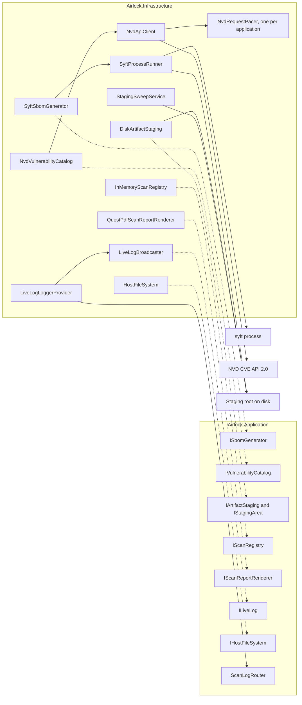
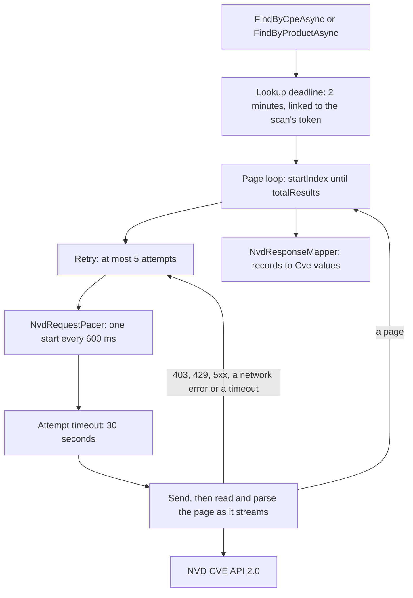

# U3 Infrastructure — Logical Components

**Stage**: CONSTRUCTION — U3 Infrastructure — NFR Design (Standard depth)

Both diagrams were validated with Mermaid 11.4.1; each has a text alternative.

## Namespaces in `Airlock.Infrastructure`

| Namespace | Types |
|---|---|
| `Airlock.Infrastructure` | `InfrastructureServiceCollectionExtensions` (`AddAirlockInfrastructure`), `AirlockConfigurationBuilderExtensions` (`AddAirlockEnvironmentVariables`); internal `AirlockEnvironmentVariables`, the configuration source for `NVD_API_KEY`, `SYFT_BINARY_PATH` and `LOG_LEVEL` |
| `Airlock.Infrastructure.Options` | `NvdOptions`, `SyftOptions`, `StagingOptions`; internal `NvdOptionsValidator`, `SyftOptionsValidator`, `StagingOptionsValidator` |
| `Airlock.Infrastructure.Syft` | `SyftSbomGenerator`; internal `SyftProcessRunner`, `SyftRunRequest`, `SyftRunResult<T>`, `SyftLocator` (IR-06), `SyftStatusProbe` (IR-05, with its cache), `SyftJsonParser`, `SyftJsonContext` with its records, `NuspecReader`, `SyftLog` |
| `Airlock.Infrastructure.Nvd` | `NvdVulnerabilityCatalog`; internal `NvdApiClient`, `NvdQuery`, `NvdAttempt` (`NvdPage`, `NvdNotFound`, `NvdRetryable`, `NvdFailed`), `NvdPipeline` (the Polly pipeline and its backoff), `NvdRequestPacer`, `CpeMatchString` (IR-07), `NvdResponseMapper`, `NvdJsonContext` with its records, `NvdLog` |
| `Airlock.Infrastructure.Staging` | `DiskArtifactStaging`; internal `DiskStagingArea`, `StagingFolders` (creating marked folders, deleting with retries), `StagingSweepService` (`IHostedService`), `StagingLog` |
| `Airlock.Infrastructure.Scans` | `InMemoryScanRegistry` |
| `Airlock.Infrastructure.Logging` | `LiveLogBroadcaster`, `LiveLogLoggerProvider` |
| `Airlock.Infrastructure.Reports` | `QuestPdfScanReportRenderer`; internal `ScanReportDocument` (QuestPDF's `IDocument`), `ReportLog` |
| `Airlock.Infrastructure.FileSystem` | `HostFileSystem` |

## Registrations

`AddAirlockInfrastructure(services, configuration)` registers, after the host has called `AddAirlockApplication`:

| Service | Implementation | Lifetime |
|---|---|---|
| `ISbomGenerator` | `SyftSbomGenerator` | Singleton; it holds Syft's status cache |
| `IVulnerabilityCatalog` | `NvdVulnerabilityCatalog` | Singleton |
| `NvdApiClient`, `NvdRequestPacer` and the NVD pipeline | — | Owned by the one catalog, so one turn order for the whole application; the client asks `IHttpClientFactory` for the named client `Airlock.Nvd` on each request, so the factory's handler rotation still applies |
| `IArtifactStaging` | `DiskArtifactStaging` | Singleton |
| `IScanRegistry` | `InMemoryScanRegistry` | Singleton |
| `IScanReportRenderer` | `QuestPdfScanReportRenderer` | Singleton |
| `ILiveLog` | `LiveLogBroadcaster` | Singleton, the same instance the provider publishes to |
| `ILoggerProvider` | `LiveLogLoggerProvider` | Singleton, with its own filter rules |
| `IHostFileSystem` | `HostFileSystem` | Singleton |
| `IHostedService` | `StagingSweepService` | Runs once at startup |
| `TimeProvider` | `TimeProvider.System`, added only if none is registered, as in the Application | Singleton |

The named client `Airlock.Nvd` has the base URL, an infinite `HttpClient.Timeout` (the pipeline and the lookup deadline
own time), `Accept: application/json`, a `User-Agent` naming Airlock and its version, and gzip and Brotli
decompression. The factory's own logging is removed for it — its structured state would carry the raw `apiKey` header
— and headers stay redacted for any logger added later.

## How they connect

Text alternative: dotted arrows mean "implements". `SyftSbomGenerator` implements `ISbomGenerator`,
`NvdVulnerabilityCatalog` implements `IVulnerabilityCatalog`, `DiskArtifactStaging` implements `IArtifactStaging` (and,
through its internal `DiskStagingArea`, `IStagingArea`), `InMemoryScanRegistry` implements `IScanRegistry`,
`QuestPdfScanReportRenderer` implements `IScanReportRenderer`, `LiveLogBroadcaster` implements `ILiveLog` and
`HostFileSystem` implements `IHostFileSystem`. Solid arrows mean "uses". `SyftSbomGenerator` runs the syft process
through `SyftProcessRunner`, which gives each run a temporary folder under the staging root. `NvdVulnerabilityCatalog`
asks `NvdApiClient` for pages; before each request to the NVD CVE API 2.0, the client takes a turn from the one
`NvdRequestPacer`. `DiskArtifactStaging` stores uploads under the staging root, and `StagingSweepService` removes the
marked folders an earlier run left there. `LiveLogLoggerProvider` publishes every Airlock log entry to
`LiveLogBroadcaster` and hands scan-scoped entries to the Application's `ScanLogRouter`.

## The path of one NVD lookup

Text alternative: a lookup — `FindByCpeAsync` or `FindByProductAsync` — starts a 2-minute deadline linked to the scan's
token. Within it, the page loop asks for pages from `startIndex` 0 until `totalResults` is reached. Each page goes
through the retry, at most 5 attempts. Each attempt first takes a turn from `NvdRequestPacer`, one request start every
600 ms, then runs under a 30-second attempt timeout that covers sending the request and reading and parsing the page as
it streams from the NVD CVE API 2.0. A 403, a 429, a 5xx, a network error or an attempt timeout goes back to the retry;
a page goes back to the page loop. When every page is in, `NvdResponseMapper` turns the records into `Cve` values.

## Checks introduced in U3

| Check | Project | Enforces |
|---|---|---|
| Architecture rule 3 | `Airlock.Architecture.Tests` | Infrastructure references no Web or ASP.NET Core assembly and depends on no such namespace (U3-NFR-01) |
| Architecture rule 4, Infrastructure half | `Airlock.Architecture.Tests` | Each of the eight port interfaces has exactly one implementation, in `Airlock.Infrastructure` (U3-NFR-01) |
| Pacing compliance | `Airlock.Infrastructure.Tests` | 16 callers with injected 429s on a fake clock: starts at least 600 ms apart and never more than 50 in 30 seconds; a cancelled waiter gives up its turn (U3-NFR-03, defect 9) |
| Retries and timeouts | `Airlock.Infrastructure.Tests` | Attempts and delays with a seeded random source; `Retry-After: 0` and `Retry-After: 7`; the attempt timeout during a slow body; the 2-minute deadline; 404 as no records; a broken body never retried (U3-NFR-02) |
| No key anywhere | `Airlock.Infrastructure.Tests` | A full lookup and a Syft run logged at Trace in every category — exceptions and health details included — hold no key; nor does Syft's environment (U3-NFR-07) |
| Process tree | `Airlock.Infrastructure.Tests` | The stand-in and its child are gone within 1 second of cancellation and of the time limit; 1 MB of error output leaves a 4 KB tail; a full output pipe never blocks (U3-NFR-04) |
| Streaming staging | `Airlock.Infrastructure.Tests` | A generated 256 MiB upload is staged with under 16 MB allocated; the byte limit reached mid-stream leaves nothing behind (U3-NFR-05) |
| Hostile NuGet packages | `Airlock.Infrastructure.Tests` | A `.nuspec` past 1 MB, an archive announcing more than 65,534 entries and a `.nuspec` with a DTD all count as unreadable (U3-NFR-05, U3-NFR-07) |
| Deletion | `Airlock.Infrastructure.Tests` | Read-only files and folders are deleted; a locked file is retried, then reported; the sweep removes marked folders only (U3-NFR-06) |
| Live Log fan-out | `Airlock.Infrastructure.Tests` | Two subscribers receive every line; a subscriber that never reads slows nothing; a new one first gets the last 200; Debug lines still arrive when `LOG_LEVEL` is `WARNING` (U3-NFR-09, defect 4) |
| Options and startup | `Airlock.Infrastructure.Tests` | Each range in the values table, at both ends; an `http` base URL refused; the `LOG_LEVEL` names; no key and no Syft still start (U3-NFR-11) |
| PDF smoke | `Airlock.Infrastructure.Tests` | PdfPig finds every section's heading in the reports of a Completed and an Incomplete scan (IR-20) |
| Performance bounds | `Airlock.Infrastructure.Tests` | Ten times the U3-NFR-10 targets |
| Real Syft | `Airlock.Infrastructure.Tests`, `Category=Integration` | Inputs the tests build — a requirements file, a wheel, a NuGet package, an image archive — and Syft's own binary through Syft v1.55.0, and a real run killed mid-scan |
| Infrastructure clock rule | `Airlock.Architecture.Tests` | No clock reads, stopwatches, timers or untimed delays in Infrastructure code (code generation refinement 3) |
| One scan through both layers | `Airlock.Infrastructure.Tests` | The composed Application and Infrastructure, the stand-in as Syft and the fake NVD: a Completed scan whose events carry the Infrastructure's own lines (IR-16) |
| Live NVD | `Airlock.Infrastructure.Tests`, `Category=Network` | One lookup without a key, only when `AIRLOCK_LIVE_NVD=1` |

Each architecture rule has a positive control, as in U1 and U2.

## Constraints handed to U4 and U6

- **U4 (host)**:
  - Add `AddAirlockEnvironmentVariables()` after the JSON configuration files, so the original variables win over them.
  - Bind `AirlockOptions` from `Airlock`, then call `AddAirlockApplication` and `AddAirlockInfrastructure`.
  - The health endpoint reports `ISbomGenerator.GetStatusAsync` and `IVulnerabilityCatalog.IsConfigured` as they are,
    with no NVD probe (N6).
  - One Airlock runs per staging root.
- **U6 (delivery)**:
  - The image puts Syft v1.55.0 in `bin/` next to the application (IR-06) and gives the non-root user a writable
    staging root.
  - CI installs Syft with the install script, so the integration tests run on Windows and Linux and count towards
    coverage.
  - The README tells developers to point `SYFT_BINARY_PATH` at the repository's `bin/syft`, or to put Syft on the
    path: the application's own folder is its build output, not the repository root.
