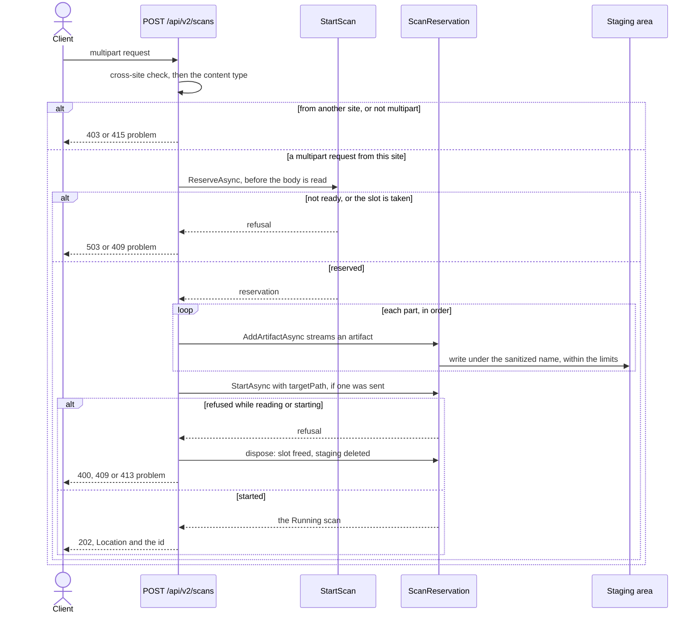
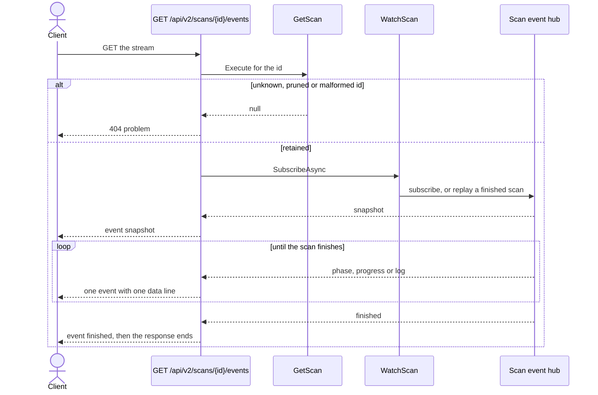
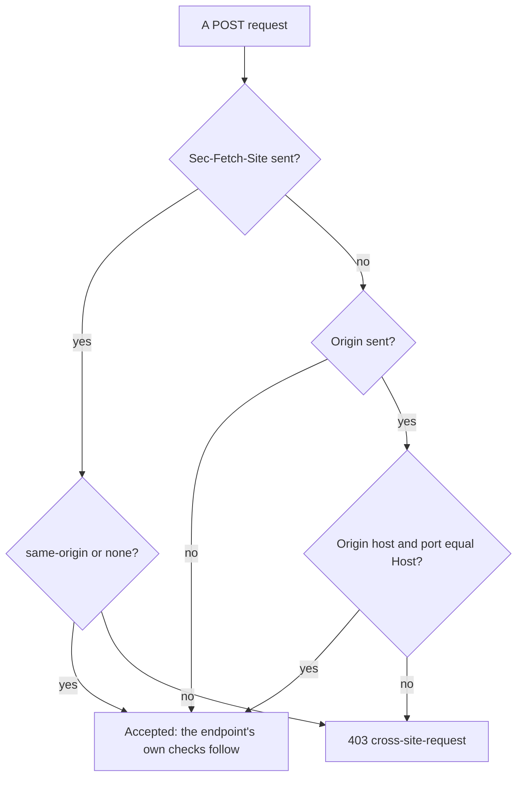

# U4 Web API — Business Logic Model

**Stage**: CONSTRUCTION — U4 Web API — Functional Design (Standard depth)

How a submission and an event stream go, how a `POST` is checked for other websites, the statuses each endpoint
answers, worked requests and responses, and the rule-to-test map. Rules are WR-nn (`business-rules.md`). The three
diagrams were validated with Mermaid 11.4.1; each has a text alternative.

## A submission



Text alternative: the endpoint first refuses a request from another website (403) or one that is not multipart
(415). It then reserves the active slot before reading any of the body; when Airlock is not ready or the slot is taken
it answers 503 or 409 at once. With the reservation it reads the parts in order, streaming each artifact into the
staging area under its sanitized name while the count and byte limits are enforced, and finally starts the scan with
the target path when one was sent. A refusal while reading or starting — a bad part, too many files, too many bytes,
a bad target, Emergency Stop — disposes the reservation, which frees the slot and deletes the staging area, and
answers 400, 409 or 413. Otherwise it answers 202 with the `Location` and the scan id (WR-06 to WR-09).

## An event stream



Text alternative: the endpoint looks the scan up first and answers 404 when it is unknown, pruned or malformed.
Otherwise it subscribes through `WatchScan`, which follows the scan's event hub, or replays a finished scan from the
registry. The client receives the `snapshot` first, then each `phase`, `progress` and `log` event as one event with
one compact `data` line, and `finished` last, after which the server ends the response (WR-12, WR-13).

## Requests from other websites



Text alternative: a `POST` that carries `Sec-Fetch-Site` is accepted only when the value is `same-origin` or `none`. A
`POST` without it is accepted when it carries no `Origin` either — curl and CI clients send neither — or when its
`Origin` names the same host and port as its `Host`. Everything else is refused with 403 `cross-site-request`
(WR-19). Before any of this, a `Host` outside `AllowedHosts` has already been refused by the host filter (WR-20).

## Statuses by endpoint

| Endpoint | Success | Problems |
|---|---|---|
| `POST /api/v2/scans` | 202 | 400 `invalid-request`, `invalid-target`, `too-many-artifacts`; 403 `cross-site-request`; 409 `scan-in-progress`, `upload-stopped`; 413 `too-large`; 415 `unsupported-media-type`; 503 `not-ready` |
| `GET /api/v2/scans/{id}` | 200 | 404 `scan-not-found` |
| `GET /api/v2/scans/{id}/events` | 200 | 404 `scan-not-found` |
| `GET /api/v2/scans/{id}/report.pdf` | 200 | 404 `scan-not-found`; 409 `scan-not-finished`, `scan-has-no-results` |
| `POST /api/v2/scans/{id}/cancel` | 200, 202 | 403 `cross-site-request`; 404 `scan-not-found`; 409 `scan-already-finished` |
| `POST /api/v2/system/stop` | 200 | 403 `cross-site-request` |
| `GET /api/v2/system/health` | 200 | — |
| `GET /api/v2/logs/stream` | 200 | — |
| Any address under `/api` | — | 404 `not-found`; 405 `method-not-allowed`; 500 `unexpected-error` |

A `Host` outside `AllowedHosts` gets the host filter's plain 400 at any address (WR-20).

## Worked requests and responses

The examples use the S0 `requirements.txt` (flask 0.12.2, jinja2 2.10, pyyaml 5.3, requests 2.25.1) and the NVD
answers recorded for it in U3's fixtures. The port is illustrative (U4 Infrastructure Design fixes it), the trace id
is invented, and long descriptions are shortened with "…".

### Submit (E03 "Submit and poll")

```bash
curl -i -F artifacts=@requirements.txt http://localhost:8080/api/v2/scans
```

```http
HTTP/1.1 202 Accepted
Location: /api/v2/scans/01a1637b-7e00-7c3a-9f12-6b84d0e5a1c7
Content-Type: application/json; charset=utf-8
Cache-Control: no-store

{
  "id": "01a1637b-7e00-7c3a-9f12-6b84d0e5a1c7",
  "status": "RUNNING"
}
```

### Poll while it runs

`GET /api/v2/scans/01a1637b-7e00-7c3a-9f12-6b84d0e5a1c7` during correlation:

```json
{
  "id": "01a1637b-7e00-7c3a-9f12-6b84d0e5a1c7",
  "status": "RUNNING",
  "phase": "CORRELATION",
  "progress": {
    "correlated": 2,
    "total": 4
  },
  "target": {
    "kind": "ARTIFACTS",
    "path": null,
    "artifacts": [
      {
        "fileName": "requirements.txt",
        "sizeBytes": 56,
        "kind": "MANIFEST"
      }
    ]
  },
  "startedAt": "2026-10-22T12:00:00.000Z",
  "finishedAt": null,
  "durationSeconds": null,
  "summary": null,
  "vulnerablePackages": [],
  "unverifiedPackages": [],
  "warnings": [],
  "failure": null,
  "cancellationReason": null
}
```

### The finished scan, which is also the JSON export

NVD answered 503 for jinja2 2.10 through every retry, so the scan is `INCOMPLETE`. pyyaml 5.3 matched its generated
CPE; no candidate CPE of flask 0.12.2 has NVD records, so it was matched by product (ADR-0006); requests 2.25.1 has
only MEDIUM CVEs and is clean.

```json
{
  "id": "01a1637b-7e00-7c3a-9f12-6b84d0e5a1c7",
  "status": "INCOMPLETE",
  "phase": "SUMMARY",
  "progress": {
    "correlated": 4,
    "total": 4
  },
  "target": {
    "kind": "ARTIFACTS",
    "path": null,
    "artifacts": [
      {
        "fileName": "requirements.txt",
        "sizeBytes": 56,
        "kind": "MANIFEST"
      }
    ]
  },
  "startedAt": "2026-10-22T12:00:00.000Z",
  "finishedAt": "2026-10-22T12:01:32.418Z",
  "durationSeconds": 92.418,
  "summary": {
    "totalPackages": 4,
    "vulnerablePackages": 2,
    "cleanPackages": 1,
    "unverifiedPackages": 1,
    "criticalFindings": 2,
    "highFindings": 3
  },
  "vulnerablePackages": [
    {
      "type": "python",
      "name": "pyyaml",
      "version": "5.3",
      "highestSeverity": "CRITICAL",
      "matchMethod": {
        "kind": "CPE",
        "cpe": "cpe:2.3:a:pyyaml:pyyaml:5.3:*:*:*:*:*:*:*",
        "cpeSource": "GENERATED",
        "product": null
      },
      "findings": [
        {
          "cveId": "CVE-2020-14343",
          "severity": "CRITICAL",
          "baseScore": 9.8,
          "cvssVersion": "3.1",
          "scoreSource": "PRIMARY",
          "nvdUrl": "https://nvd.nist.gov/vuln/detail/CVE-2020-14343",
          "description": "A vulnerability was discovered in the PyYAML library in versions before 5.4, where it is susceptible to arbitrary code execution when it processes untrusted YAML files through the full_load method or with the FullLoader loader. …"
        },
        {
          "cveId": "CVE-2020-1747",
          "severity": "CRITICAL",
          "baseScore": 9.8,
          "cvssVersion": "3.1",
          "scoreSource": "PRIMARY",
          "nvdUrl": "https://nvd.nist.gov/vuln/detail/CVE-2020-1747",
          "description": "A vulnerability was discovered in the PyYAML library in versions before 5.3.1, where it is susceptible to arbitrary code execution when it processes untrusted YAML files through the full_load method or with the FullLoader loader. …"
        }
      ]
    },
    {
      "type": "python",
      "name": "flask",
      "version": "0.12.2",
      "highestSeverity": "HIGH",
      "matchMethod": {
        "kind": "PRODUCT",
        "cpe": null,
        "cpeSource": null,
        "product": "flask"
      },
      "findings": [
        {
          "cveId": "CVE-2018-1000656",
          "severity": "HIGH",
          "baseScore": 7.5,
          "cvssVersion": "3.0",
          "scoreSource": "PRIMARY",
          "nvdUrl": "https://nvd.nist.gov/vuln/detail/CVE-2018-1000656",
          "description": "The Pallets Project flask version Before 0.12.3 contains a CWE-20: Improper Input Validation vulnerability in flask that can result in Large amount of memory usage possibly leading to denial of service. …"
        },
        {
          "cveId": "CVE-2019-1010083",
          "severity": "HIGH",
          "baseScore": 7.5,
          "cvssVersion": "3.0",
          "scoreSource": "PRIMARY",
          "nvdUrl": "https://nvd.nist.gov/vuln/detail/CVE-2019-1010083",
          "description": "The Pallets Project Flask before 1.0 is affected by: unexpected memory usage. The impact is: denial of service. …"
        },
        {
          "cveId": "CVE-2023-30861",
          "severity": "HIGH",
          "baseScore": 7.5,
          "cvssVersion": "3.1",
          "scoreSource": "PRIMARY",
          "nvdUrl": "https://nvd.nist.gov/vuln/detail/CVE-2023-30861",
          "description": "Flask is a lightweight WSGI web application framework. When all of the following conditions are met, a response containing data intended for one client may be cached and subsequently sent by the proxy to other clients. …"
        }
      ]
    }
  ],
  "unverifiedPackages": [
    {
      "type": "python",
      "name": "jinja2",
      "version": "2.10",
      "reason": "LOOKUP_FAILED",
      "detail": "NVD returned 503"
    }
  ],
  "warnings": [],
  "failure": null,
  "cancellationReason": null
}
```

The counts add up (E06): 4 packages = 1 clean + 2 vulnerable + 1 unverified. The finding cards count CVEs: 2 CRITICAL
(pyyaml) and 3 HIGH (flask); flask's MEDIUM CVE-2026-27205 is below the threshold. Within a package the findings run
from the highest severity and score down, then by CVE id (U1 BR-07), which puts CVE-2020-14343 before CVE-2020-1747.

### Follow the events (E03 "Follow the event stream")

```text
$ curl -N http://localhost:8080/api/v2/scans/01a1637b-7e00-7c3a-9f12-6b84d0e5a1c7/events
event: snapshot
data: {"id":"01a1637b-7e00-7c3a-9f12-6b84d0e5a1c7","status":"RUNNING","phase":"SBOM_GENERATION","progress":null, …}

event: log
data: {"timestamp":"2026-10-22T12:00:00.004Z","level":"INFO","category":"Airlock.Application.Scanning.ScanPipeline","message":"📥 Processing 1 uploaded artifact(s)"}

   … log events while Syft runs …

event: phase
data: {"phase":"CORRELATION"}

event: progress
data: {"correlated":0,"total":4}

   … progress and log events …

event: phase
data: {"phase":"SUMMARY"}

event: log
data: {"timestamp":"2026-10-22T12:01:32.416Z","level":"INFO","category":"Airlock.Application.Scanning.ScanPipeline","message":"✅ Vetting sequence complete: 2 vulnerable, 1 unverified, 1 clean of 4 package(s)"}

event: finished
data: {"status":"INCOMPLETE"}

```

The `snapshot` line is shortened here; on the wire it is the whole scan on one line. After `finished` the server ends
the response, and curl exits.

### Refusals

A second submission while the scan runs (E03, E04):

```json
{
  "type": "https://github.com/JJWren/Airlock-DotNet/blob/main/docs/api/problems.md#scan-in-progress",
  "title": "Scan in progress",
  "status": 409,
  "detail": "A scan is already in progress",
  "traceId": "00-6f1c2a7d9e0b4c3f8a5d2e1b0c9f7a6d-3b2a1c0d9e8f7a6b-00"
}
```

| Request | Status and problem | `detail` |
|---|---|---|
| Any submission with no NVD key and no Syft (E04) | 503 `not-ready` | NVD API key not configured; Syft not found at /opt/airlock/bin/syft |
| `-F targetPath=/uploads/acme-ap`, a mistyped path (E01) | 400 `invalid-target` | Target path does not exist |
| `-F targetPath=/etc` with `AllowedScanRoots` = `/uploads` (E01) | 400 `invalid-target` | Path is outside the allowed scan roots |
| No fields at all (E04) | 400 `invalid-target` | Choose a directory or upload at least one artifact |
| `-F targetPath=/uploads -F artifacts=@requirements.txt` | 400 `invalid-target` | Choose a directory or upload artifacts, not both |
| 26 `artifacts` parts (E02) | 400 `too-many-artifacts` | At most 25 files per scan |
| 2.5 GB of artifacts (E02) | 413 `too-large` | Uploads are limited to 2 GB per scan |
| `-F files=@requirements.txt`, the original's field name | 400 `invalid-request` | Unknown form field 'files'; expected 'targetPath' or 'artifacts' |
| `-H 'Content-Type: application/json' -d '{"targetPath":"/uploads"}'` | 415 `unsupported-media-type` | Scans are submitted as multipart/form-data |
| A form posted by a page on another site (`Sec-Fetch-Site: cross-site`) | 403 `cross-site-request` | Requests from other websites are not accepted |
| An upload under way when Emergency Stop is pressed | 409 `upload-stopped` | Emergency Stop ended the upload before the scan started |
| `GET …/report.pdf` while the scan runs (E03, E11) | 409 `scan-not-finished` | The scan is still running |
| `GET /api/v2/scans/{id}` 25 hours after it finished (E03) | 404 `scan-not-found` | Scan not found or no longer retained |

### Stop and cancel

`POST /api/v2/system/stop` while the scan runs, and again when nothing does:

```json
{
  "status": "TERMINATED",
  "scanId": "01a1637b-7e00-7c3a-9f12-6b84d0e5a1c7"
}
```

```json
{
  "status": "IDLE",
  "scanId": null
}
```

`POST /api/v2/scans/{id}/cancel` answers 200 with the scan, now `CANCELLED` with `cancellationReason` "Cancelled by
request", empty lists and no summary, when the pipeline records it within 5 seconds; if Syft is slow to die it answers
202 with the scan still `RUNNING` and a `Location` to poll.

### Health (E12)

```json
{
  "status": "ONLINE",
  "version": "2.0.0",
  "checks": [
    {
      "name": "Syft",
      "passing": true,
      "detail": "1.55.0"
    },
    {
      "name": "NVD API key",
      "passing": true,
      "detail": "configured"
    }
  ]
}
```

Without a key, `status` is `DEGRADED` and the second check is
`{ "name": "NVD API key", "passing": false, "detail": "NVD API key not configured" }`; the answer is still 200.

## What U4 hands to U5

- `airlock.js` posts the form to `POST /api/v2/scans` with the fields `targetPath` and `artifacts`, reads `id` from a
  202 and `detail` from a problem for the inline message, and checks the file count and total size before uploading
  (WR-08).
- Export JSON and Export PDF are links to `GET /api/v2/scans/{id}` and `…/report.pdf`; the JSON link names the file
  `airlock_audit_<finish time>.json` (WR-11, WR-14).
- The UI's requests are same-origin, so WR-19 accepts them; the host name the analyst browses to must be in
  `AllowedHosts` (WR-20).
- The UI follows scans in-process through `WatchScan` rather than the event stream (ADR-0001).

## Left to U4 NFR and Infrastructure Design

The allowance above `Limits.MaxBytesPerScan` for the server's body limit (WR-08); Kestrel's minimum data rates and
timeouts for 2 GB uploads and for long-lived streams; whether idle streams send keep-alive comments, which clients
ignore; `X-Content-Type-Options: nosniff`; serving Scalar's assets from Airlock itself, with no CDN or web fonts, so
`/docs` works on a network without internet access; the ports; the configuration sources and their precedence; how
`AllowedHosts` is set in development, in the container and in CI; one Airlock per staging root.

## Rules to tests (U4)

In `tests/Airlock.Web.Tests`, through `WebApplicationFactory` with the real Application and fakes for Syft, NVD and the
PDF renderer, on a fake clock; no network access.

| Rules | Test class | Key cases |
|---|---|---|
| WR-01, WR-10 | `ScanResourceTests` | The shape for `RUNNING`, `COMPLETED`, `INCOMPLETE`, `FAILED` and `CANCELLED`; 404 for an unknown id, a pruned scan (the clock past 24 hours), a malformed id and the empty GUID |
| WR-02, WR-11 | `JsonContractTests` | camelCase names and capitalized values; UTC with milliseconds and `Z`; `null` and `[]`; two-space indentation; an apostrophe and an emoji written as they are; `Cache-Control: no-store`; the finished scan of the worked example, with its descriptions in full, byte for byte |
| WR-03 to WR-05 | `ProblemDetailsTests` | Every `RefusalCode` to its status, `type`, `title` and `detail`; 404 for an unknown address; 405 with `Allow`; 500 from a fake port that throws with a secret-looking message: neither the message, the stack nor the key appears; `traceId` present; `application/problem+json` |
| WR-06 to WR-09 | `ScanSubmissionTests` | 202 with `Location` for artifacts and for a path; 415; a multipart type without boundary; 503 with both reasons and no byte read; 409 while a scan runs and while another upload is under way; an unknown field; a second `targetPath`; an artifact without a name; a browser's empty part skipped; both targets refused before the rest of the body is read; neither target; a broken body; a disconnect frees the slot and deletes the staging area; the 26th file; the byte limit mid-stream; an upload larger than the test's memory budget streams without buffering |
| WR-12, WR-13 | `ScanEventStreamTests` | `snapshot` first and `finished` last, then the response ends; a finished scan's two events; 404; one `event:` and one `data:` line per event, no `id:` |
| WR-14 | `ReportEndpointTests` | 200 with `application/pdf` and the file name; 409 while running; 409 for `FAILED` and `CANCELLED`; 404 |
| WR-15, WR-16 | `StopEndpointTests` | Cancel: 200 within the grace period, 202 past it, 409 when finished, 404; Emergency Stop: `TERMINATED` with the id, `IDLE`; Emergency Stop during an upload answers that upload 409 `upload-stopped` |
| WR-17 | `HealthEndpointTests` | `ONLINE`; `DEGRADED` for the key, for Syft and for both, still 200; version 2.0.0; no NVD request |
| WR-18 | `LiveLogStreamTests` | The replay first, then live lines; `scanId` set and `null` |
| WR-19 to WR-21 | `CrossSiteTests` | `Sec-Fetch-Site` `cross-site` and `same-site` refused on each `POST`; `same-origin` and `none` accepted; a foreign and a `null` `Origin` refused; neither header accepted; `GET` unaffected; a host outside `AllowedHosts` answered 400, an added name accepted; no antiforgery token needed |
| WR-22 | `OpenApiDocumentTests` | Every endpoint and status of WR-01 in `/openapi/v2.json`; the multipart body; problem responses; the enumeration values; the schema names; `/docs` answers 200 |
| WR-23 | `HostCompositionTests` | The real composition starts with the default configuration; an invalid option stops startup naming it; no key starts `DEGRADED`; the original variable names are read |
| WR-23 | `Airlock.Architecture.Tests` | Rule 5 for endpoints: Web types call Application use cases and never Infrastructure types — only the composition root, `AirlockHost`, does — with a positive control |

### Regression tests for the defects U4 owns

| Defect | Regression test |
|---|---|
| 6 — A mistyped path read as "0 packages, clean" | A missing path answers 400 "Target path does not exist" and records no scan |
| 7 — A missing NVD key was reported clean | A submission answers 503 "NVD API key not configured" and records no scan |
| 14 — `POST /scan` held the request open for minutes, with no progress | The submission answers 202 while the scan runs, and the event stream delivers its phases and progress |
| 15 — Concurrent scans overwrote each other's state | A second submission answers 409 while a scan runs or uploads, and the first is unaffected |
| 18 — README drift: an unused server PDF endpoint and a JSON body the API never accepted | The UI's and the API's PDF come from one endpoint; a JSON body answers 415 with the reason |
