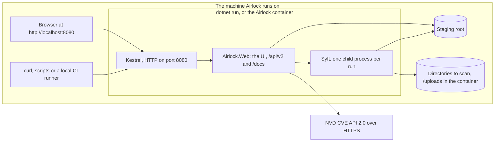

# U4 Web API — Deployment Architecture

**Stage**: CONSTRUCTION — U4 Web API — Infrastructure Design (Minimal depth)

Airlock is one process on one machine, run with `dotnet run` or as one container (NFR-01, D3). The diagram was
validated with Mermaid 11.4.1 and has a text alternative.

Text alternative: on the machine Airlock runs on, a browser at `http://localhost:8080` and API clients such as curl,
scripts or a local CI runner reach Kestrel, which serves HTTP on port 8080, whether Airlock runs under `dotnet run` or
in its container. Kestrel hands every request to `Airlock.Web`, which serves the UI, `/api/v2` and `/docs`. Airlock
starts one Syft child process per run; Airlock and Syft both work in the staging root on disk, and Syft also reads the
directories being scanned, which the container sees under `/uploads`. Airlock's only outbound connection is to the NVD
CVE API 2.0 over HTTPS.

## Exposure

| Setup | Listens on | Reachable from | Host names answered |
|---|---|---|---|
| `dotnet run`, or the published application | `localhost:8080` | This machine | `localhost`, `127.0.0.1`, `[::1]` (WR-20) |
| The container, as U6 ships it | Port 8080 on every interface inside the container, published on the host as `127.0.0.1:8080` | This machine | The same |
| Opened to other machines, by an operator's choice | Published on another interface | Whoever can reach it | The names the operator adds to `AllowedHosts` |

Opening Airlock to other machines means three changes, which the README (U6) describes together: publish the port on
another interface; add the names clients use to `AllowedHosts`; and put a TLS reverse proxy in front, since Airlock
has no authentication (D2) and speaks plain HTTP. The proxy should pass `X-Accel-Buffering: no` through for the event
streams. A CI job on another machine is such a client.

## Outbound connections

| To | Port | Why | Notes |
|---|---|---|---|
| `services.nvd.nist.gov` | 443 | CVE lookups (U3) | `HttpClient` uses the system proxy on Windows and `HTTPS_PROXY` / `NO_PROXY` on Linux, so a corporate proxy needs no Airlock setting |
| Nothing else | — | — | Syft runs with its update check off (U3 IR-01); `/docs` loads nothing from elsewhere (U4-NFR-07) |

## Disk and processes

- **Staging root**: `<system temp>/airlock-staging` by default; one folder per scan, deleted when the scan ends
  (FR-03), locked by one Airlock at a time (U4-NFR-09). Plan for about three times the largest upload in free space:
  the upload, Syft's unpacked copy of an archive or image, and its temporary files.
- **Directories to scan**: any directory on the host, or only those under `Airlock:AllowedScanRoots` when it is set;
  in the container, the host folder `SCAN_UPLOAD_PATH` mounted at `/uploads`.
- **Syft**: v1.55.0, found as U3 IR-06 describes; each run is a child process that Airlock kills with its whole tree
  when a scan stops (U3-NFR-04).

## Handed to U6

- **Image**: `URLS=http://+:8080` (required: `appsettings.json` pins the loopback address, and outranks
  `ASPNETCORE_URLS`, as U6's NFR Design found), `EXPOSE 8080`, the
  .NET image's non-root user, a writable staging root for that user, and Syft v1.55.0 in `bin/` next to the
  application.
- **Compose**: publish `127.0.0.1:${AIRLOCK_PORT:-8080}:8080`, so the port can move without editing the file; take
  `NVD_API_KEY` from `.env`; mount `SCAN_UPLOAD_PATH` read-only at `/uploads`, and consider setting
  `Airlock__AllowedScanRoots__0=/uploads` so the container scans nothing else; the default 10-second stop grace period
  is enough.
- **Health check**: `GET http://localhost:8080/api/v2/system/health` expects 200; the .NET runtime image has no curl,
  so U6 chooses the command.
- **Smoke test**: the container answers on the published port, which catches a listening address left on the
  container's loopback.
- **README**: the address, the user-secrets command for the NVD key, the configuration table of
  `infrastructure-design.md`, and how to open Airlock to other machines safely.
