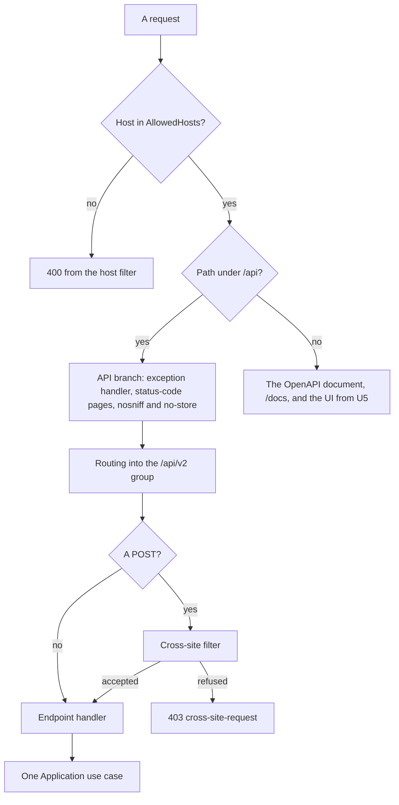
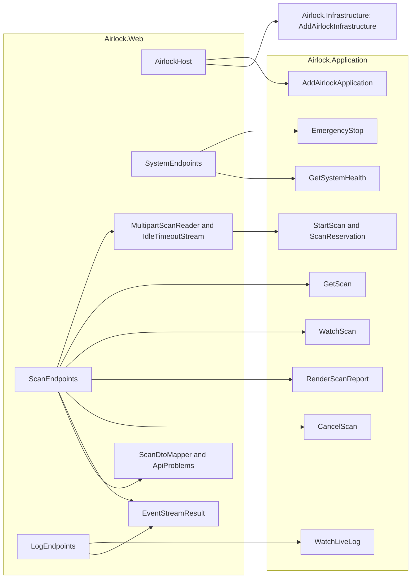

# U4 Web API — Logical Components

**Stage**: CONSTRUCTION — U4 Web API — NFR Design (Standard depth)

Both diagrams were validated with Mermaid 11.4.1; each has a text alternative. U5 adds the UI's namespaces, its
registrations and its place in the pipeline.

## Namespaces in `Airlock.Web` (U4)

| Namespace | Types |
|---|---|
| `Airlock.Web` | `Program`, whose top-level statements create the builder, call `AirlockHost` and run, and whose public partial class .NET 10 generates; `AirlockHost`, the composition root; `ConfigurationOrder` |
| `Airlock.Web.Api` | `ApiEndpoints` (`AddAirlockApi`, `UseAirlockApi`, `MapAirlockApi`, the `/api/v2` group), `ScanEndpoints`, `SystemEndpoints`, `LogEndpoints`, `ApiLimits` |
| `Airlock.Web.Api.Contracts` | The DTOs and contract enumerations of `functional-design/domain-entities.md`; `ApiJsonContext` (source-generated) and `ApiJson` (the indented options for HTTP bodies and the compact ones for event data); `ApiTime` |
| `Airlock.Web.Api.Mapping` | `ScanDtoMapper`, `EventMapper` (scan events and Live Log lines to server-sent events) |
| `Airlock.Web.Api.Problems` | `ApiProblems` — the catalogue of problem kinds, `ForRefusal`, the Web's own problems and `Customize`; `ApiExceptionHandler` |
| `Airlock.Web.Api.Uploads` | `MultipartScanReader` and its `SubmissionResult` records, `IdleTimeoutStream`, `RequestBodyStream` |
| `Airlock.Web.Api.Streams` | `EventStreamResult` |
| `Airlock.Web.Api.Security` | `CrossSiteRequestFilter`, `ApiResponseHeaders` (the `nosniff` and `no-store` middleware) |
| `Airlock.Web.Api.Docs` | `ApiDocs` — the OpenAPI document (schema names, the multipart body through an operation transformer) and Scalar's options |
| `Airlock.Web.Logging` | `WebLog` |

Every type is internal; `Airlock.Web.Tests` sees them through `InternalsVisibleTo`.

## Registrations in `AirlockHost`

| Concern | Registration |
|---|---|
| Configuration | `WebApplication.CreateBuilder` (JSON files, user-secrets in Development, environment variables, command line), then `AddAirlockEnvironmentVariables()`, whose source `ConfigurationOrder` moves in front of the last command-line source (`infrastructure-design/infrastructure-design.md`) |
| Kestrel | `ConfigureKestrel`: `AddServerHeader = false`, `Limits.MaxRequestBodySize` = 1 MiB |
| Options and layers | `AddOptions<AirlockOptions>().BindConfiguration("Airlock")`, `AddAirlockApplication()`, `AddAirlockInfrastructure(builder.Configuration)` |
| JSON | `ConfigureHttpJsonOptions` with `ApiJson.Configure`: the source-generated context, the contract enumerations' names, indented output and the relaxed encoder |
| Problems | `AddProblemDetails` with `ApiProblems.Customize`, which fills in `type`, `title` and `traceId` from the status or the refusal; `AddExceptionHandler<ApiExceptionHandler>` |
| OpenAPI | `AddOpenApi("v2")` in `ApiDocs.AddAirlockOpenApi`, with the schema names, the document's title and an operation transformer for the multipart body |
| Not registered | CORS, response compression, HTTPS redirection, HSTS |

The pipeline, in order: host filtering (which `WebApplication` runs first); a branch for `/api` with
`UseExceptionHandler`, `UseStatusCodePages` and `ApiResponseHeaders`; routing; then the endpoints — `MapAirlockApi()`,
`MapOpenApi()`, `MapScalarApiReference("/docs", ApiDocs.Configure)` and, from U5, the Razor components with their
antiforgery.

Text alternative: a request whose `Host` is not in `AllowedHosts` gets a 400 from the host filter. A request under
`/api` passes through the API branch — the exception handler, the status-code pages, and the `nosniff` and
`no-store` headers — and is routed into the `/api/v2` group; anything else goes to the OpenAPI document, `/docs` or,
from U5, the UI. A `POST` passes the cross-site filter first, which refuses it with 403 or hands it on. The endpoint
handler then calls one Application use case.

## How the endpoints reach the use cases

Text alternative: arrows mean "uses". `AirlockHost`, the composition root that `Program` calls, is the only Web code
that reaches the Infrastructure, through
`AddAirlockInfrastructure`, beside `AddAirlockApplication`. `ScanEndpoints` submits scans through
`MultipartScanReader`, which reads the body through `IdleTimeoutStream` and hands each part to `StartScan` and its
`ScanReservation`; it reads scans with `GetScan`, follows them with `WatchScan`, renders reports with
`RenderScanReport` and cancels with `CancelScan`, and it writes its answers with `ScanDtoMapper`, `ApiProblems` and,
for the event stream, `EventStreamResult`. `SystemEndpoints` calls `EmergencyStop` and `GetSystemHealth`.
`LogEndpoints` streams `WatchLiveLog` through `EventStreamResult`.

## Checks introduced in U4

| Check | Project | Enforces |
|---|---|---|
| Architecture rule 5, API half | `Airlock.Architecture.Tests` | No type in `Airlock.Web` but `AirlockHost` depends on an `Airlock.Infrastructure` type; positive control: `AirlockHost` does (U4-NFR-01) |
| Streaming upload | `Airlock.Web.Tests` | A generated 256 MiB upload is staged with under 32 MB allocated, in a collection that runs alone (U4-NFR-02) |
| Body limits | `Airlock.Web.Tests`, on Kestrel | With a lowered `Limits.MaxBytesPerScan`: just under it passes, over it is 413 `too-large` as a ProblemDetails; a body over 1 MiB sent elsewhere is cut off (U4-NFR-03) |
| Stalled upload | `Airlock.Web.Tests` | A body that stops for 60 seconds of fake time frees the slot and leaves the staging root empty; a disconnect frees it at once (U4-NFR-04) |
| Keep-alive and shutdown | `Airlock.Web.Tests` | `: keep-alive` after 15 seconds of fake silence; stopping the host ends a Live Log stream within a second, and a running scan's stream with `finished` (U4-NFR-05) |
| Headers | `Airlock.Web.Tests` | `nosniff` and `no-store` on every API answer, streams and problems included; no `Server` header, no CORS headers, no compression (U4-NFR-06) |
| No details in errors | `Airlock.Web.Tests` | In the Development environment, an exception thrown by a fake port answers 500 without its message or stack; unknown addresses and methods answer problems (U4-NFR-06) |
| No key | `Airlock.Web.Tests` | A full scan through the API, logged at Debug: the key in no answer, no event and no log line (U4-NFR-06) |
| Offline docs | `Airlock.Web.Tests` | `/docs` names no other host and carries `DefaultFonts`, `Telemetry`, the agent and the developer toolbar switched off; `/openapi/v2.json` parses as OpenAPI 3.1 (U4-NFR-07) |
| Performance bounds | `Airlock.Web.Tests` | Ten times the U4-NFR-08 targets |
| No leaks | `Airlock.Web.Tests` and `Airlock.Application.Tests` | After each misbehaving-client test: the slot free, the staging root empty. The stream's source is disposed however the client leaves — it closes the connection, stops reading, or the host stops — and the hub then counts no subscriber, even one that left right after its snapshot (U4-NFR-09) |
| One Airlock per staging root | `Airlock.Infrastructure.Tests` and `Airlock.Web.Tests` | A second sweep, and a second host, on a held root fail with the root's name; the lock is released when the first stops (U4-NFR-09) |
| Startup | `Airlock.Web.Tests` | The real host starts with its defaults; each invalid option stops it, naming the option; no key and no Syft start it DEGRADED (U4-NFR-10) |

Each architecture rule has a positive control, as in U1 to U3.

## Constraints handed to U5 and U6

- **U5 (UI)**:
  - `airlock.js` posts to `POST /api/v2/scans` from the same origin with the fields `targetPath` and `artifacts`,
    checks the file count and the total size before it uploads, and reads `id` from a 202 and `detail` from a problem.
  - Export JSON and Export PDF are links to `GET /api/v2/scans/{id}` and `…/report.pdf`, the JSON link with
    `download="airlock_audit_<finish time>.json"`.
  - The UI keeps its own error handling and not-found page outside `/api`, and antiforgery for its forms; its Razor
    components are mapped after the API.
  - The UI's fonts (Inter, JetBrains Mono) and icons come from `wwwroot`, not from a font CDN, so the UI works on a
    network without internet access, as `/docs` does.
- **U6 (delivery)**:
  - The image keeps the `AllowedHosts` default, so `http://localhost:<port>` works from the host machine; the compose
    file and the README show how to add other names, such as a CI service's.
  - Any container health check calls `localhost`.
  - The README explains that TLS belongs to a reverse proxy, which should honour `X-Accel-Buffering: no` for the event
    streams, and that one Airlock runs per staging root.
  - CI runs the API tests on Windows and Linux; the Kestrel tests bind a free loopback port and need no other network.
