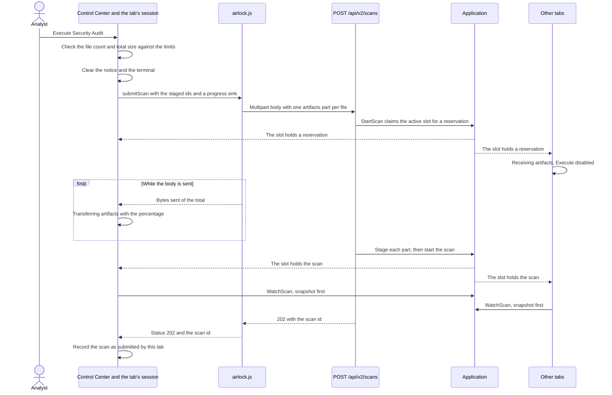
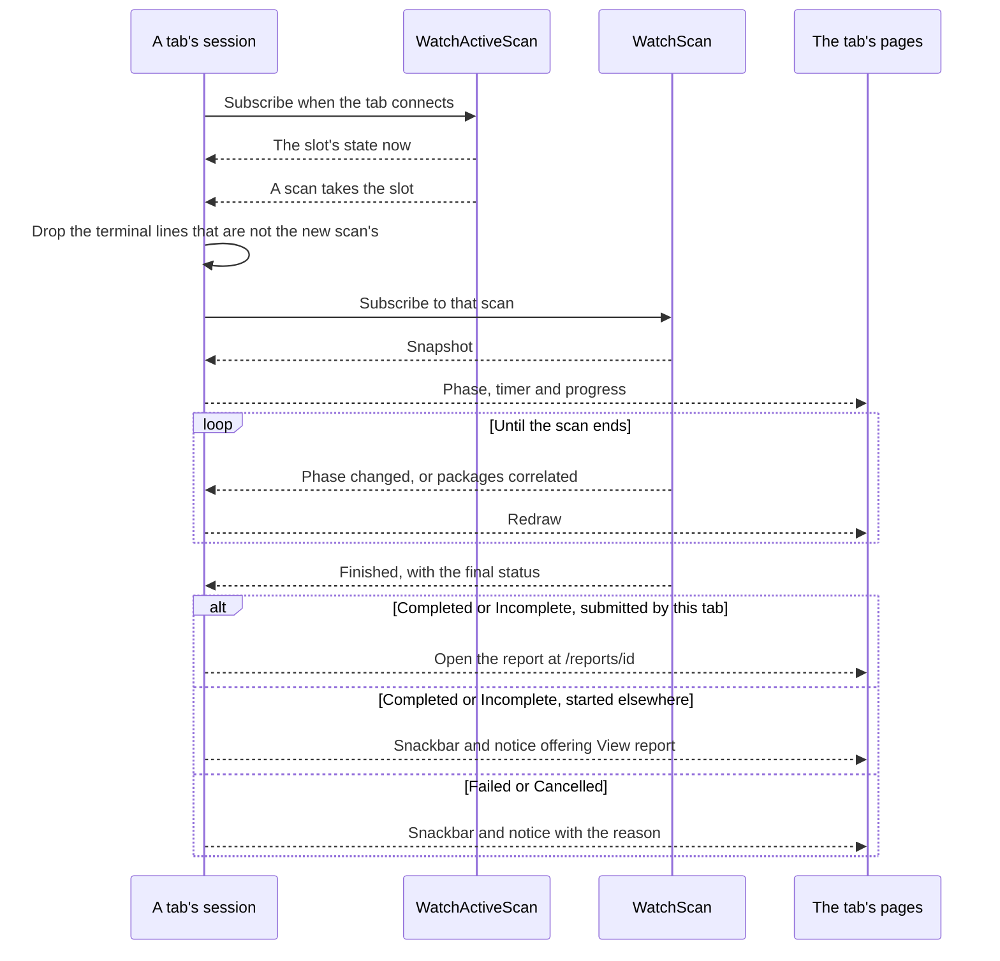
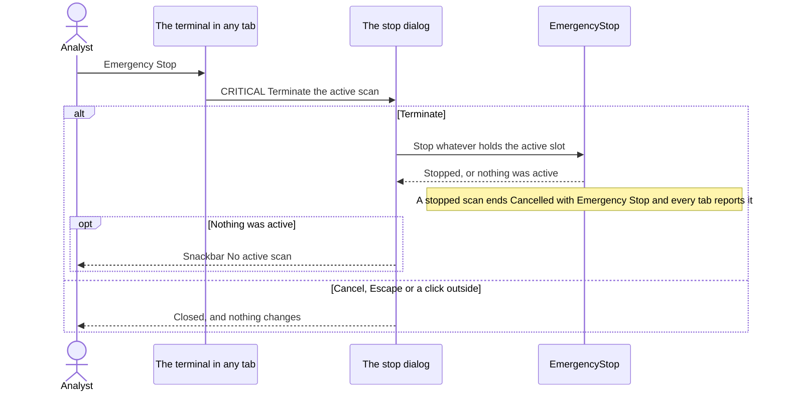
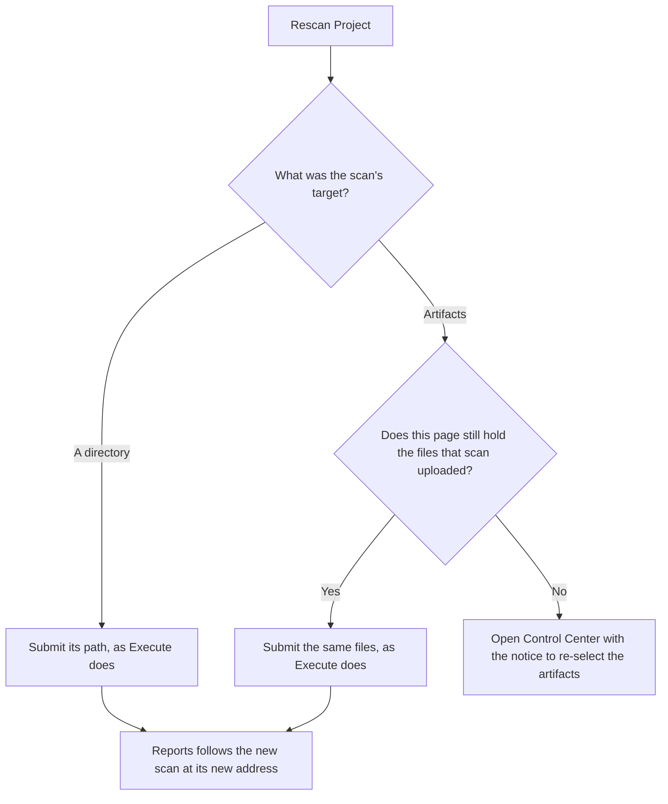
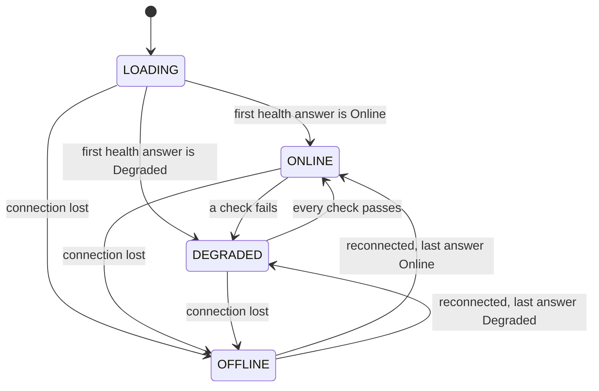

# U5 Web UI — Business Logic Model

**Stage**: CONSTRUCTION — U5 Web UI — Functional Design (Standard depth)

The flows of the UI rules (`business-rules.md`), the contract of the page's script, the worked example as it appears
on screen, and the rule-to-test map. Every diagram was validated with Mermaid 11.4.1 and has a text alternative.

## Executing a scan with artifacts



Text alternative: the analyst presses Execute Security Audit. The page checks the staged files' count and total size
against the server's limits (UR-08), clears the tab's notice and terminal, and asks `airlock.js` to submit the staged
files, passing a sink for progress. The script posts a multipart body with one `artifacts` part per file to `POST
/api/v2/scans`, where `StartScan` claims the active slot for a reservation. Every tab learns that a reservation holds
the slot: the others show "Receiving artifacts…" and disable Execute. While the body is sent, the script reports the
bytes sent and the page shows "Transferring artifacts" with the percentage. The API stages each part and starts the
scan. Every tab learns that the scan holds the slot and subscribes to its events, snapshot first. The API answers 202
with the scan id, which the script hands back, and the submitting tab records the scan as its own. A directory scan
follows the same path with `targetPath` and no progress.

## Following a scan to its end



Text alternative: when a tab connects, its session subscribes to the active slot and receives its state at once,
then every change. When a scan takes the slot, the session drops the terminal lines that do not belong to the new scan
(UR-18) and subscribes to the scan's events. The snapshot comes first, so the pages show the phase, the timer and the
progress straight away. They redraw on each phase change or progress event until the finished event arrives with the
final status. A Completed or Incomplete scan that this tab submitted opens its report at `/reports/{id}`; one started
elsewhere brings a snackbar and a notice offering "View report"; a Failed or Cancelled scan brings a snackbar and a
notice with its reason (UR-14).

## Emergency Stop



Text alternative: Emergency Stop, in the terminal of any tab, opens the dialog "CRITICAL: Terminate the active scan?".
Terminate asks `EmergencyStop` to stop whatever holds the active slot. A stopped scan ends Cancelled with the reason
"Emergency Stop", which every following tab reports (UR-14); a stopped upload is answered to its own tab with "Emergency
Stop ended the upload before the scan started". If nothing was active any more, a snackbar says "No active scan".
Cancel, Escape or a click outside closes the dialog and changes nothing (UR-20).

## Rescan



Text alternative: Rescan Project looks at the target of the scan shown. A directory is submitted again by its path, as
Execute would. Artifacts are submitted again when the page still holds the files that scan uploaded; otherwise Control
Center opens with the notice "Re-select the artifacts to rescan: …". After a submission, Reports follows the new scan
and its address becomes the new scan's (UR-33).

## The status pill



Text alternative: the pill starts as LOADING. The first health answer makes it ONLINE or DEGRADED, and later answers,
every 10 seconds, move it between the two as checks fail or pass. From any of these states a lost connection makes it
OFFLINE. When the connection returns, the pill shows the last health answer again; when reconnecting fails, it stays
OFFLINE and the bar offers Reload (UR-04, UR-05).

## Execute

| Pill | Active slot | This tab uploading | Execute | Under it |
|---|---|---|---|---|
| ONLINE | Free | No | "Execute Security Audit", enabled | — |
| Any | Held by a reservation or a scan | Any | "Vetting Sequence Active...", disabled | The Preparing line or the progress |
| Any | Free | Yes, the reservation not yet seen | "Vetting Sequence Active...", disabled | The transfer line |
| DEGRADED | Free | No | "Execute Security Audit", disabled | "Airlock is not ready: " and the failing checks' details |
| LOADING | Free | No | "Execute Security Audit", disabled | "Checking system status..." |
| OFFLINE | — | — | Unreachable while the connection is down | The connection bar (UR-05) |

Rescan Project follows the same table (UR-33).

## Reports' view

| Address | The scan | View |
|---|---|---|
| `/reports` | The tab has no current scan | None: "No audit data available. Execute a scan to begin." |
| `/reports` | The tab's current scan | That scan's view, as below |
| `/reports/{id}` | The tab follows it | That scan's view, from the session |
| `/reports/{id}` | `GetScan` finds it | That scan's view |
| `/reports/{id}` | No scan answers to the id | Not found: "Scan not found or no longer retained" |
| `/reports/{anything else}` | — | "Page not found" (UR-39) |

A scan's view follows its status: Preparing or Running, the spinner; Completed or Incomplete, the analysis; Failed or
Cancelled, the header and the reason (UR-22).

## The `airlock.js` contract

An ES module, loaded once per page; it lives as long as the page, across Blazor's navigation, and is lost on reload.

| Function | Takes | Gives | Does |
|---|---|---|---|
| `bindArtifactPicker(panel, input, sink)` | The upload panel, the hidden file input, the session's sink | — | Opens the file dialog from the panel by click, Enter or Space, in the browser, without a round trip. Adds picked files to the page's staged list — skipping any whose name and size match a staged file — reports the added `{ id, name, size }` to the sink (`Staged`), then clears the input so the same file can be picked again |
| `unstage(id)` | A staged file's id | — | Removes the file from the staged list |
| `submitScan(target, sink)` | `{ targetPath }` or `{ stagedIds }`; the session's sink | — once the upload has started | Posts `multipart/form-data` to `/api/v2/scans` with `XMLHttpRequest`: `targetPath` alone, or one `artifacts` part per file under its name. Reports the bytes sent and the total to the sink (`Progress`) at most four times a second, at least once a second while bytes move, and once at the end. The answer goes to the sink as well (`Completed`): a 202 with the scan id from the body; a problem with its `status`, `title` and `detail`; no answer as status 0. After a 202 it keeps the files under the scan id, for Rescan. No call from the server waits for the upload (U5-NFR-05) |
| `resubmitScan(scanId, sink)` | A scan id; the sink | `false` when the page holds no files for that scan, otherwise `true` once the upload has started | Rescan of artifacts, reporting as `submitScan` does (UR-33) |
| `followTerminal(element)` | The terminal's scroll area | — | Keeps the view at the newest line as lines arrive, unless the analyst has scrolled up, and again once they are back at the bottom; no round trip per line (UR-17) |
| `copyText(text)` | Text | `true` or `false` | The Clipboard API in a secure context; otherwise a hidden text area and the browser's copy command (UR-31) |
| `downloadText(fileName, text)` | A file name and text | — | Saves the text as `text/plain; charset=utf-8` under the name (UR-19) |
| `timeZone()` | — | The IANA name, such as `Europe/Berlin` | Reads `Intl.DateTimeFormat().resolvedOptions().timeZone` (UR-34) |
| `watchConnection()` | — | — | Follows Blazor's reconnection states: OFFLINE and the bar while reconnecting, Reload when reconnecting fails or the session is gone, both cleared when the connection returns (UR-05) |

The script sends nothing but the submission; the exports are links (UR-32).

## The worked example on screen

The S0 `requirements.txt` (flask 0.12.2, jinja2 2.10, pyyaml 5.3, requests 2.25.1), as in the worked example of U4's
`business-logic-model.md`: started 2026-10-22T12:00:00.000Z, finished INCOMPLETE at 12:01:32.418Z. The browser is in
`Europe/Berlin`, two hours ahead of UTC on that day.

### While it runs, at 2 of 4 packages correlated

In the tab that submitted it, Control Center shows:

- "System Status: ONLINE";
- the path dimmed with "Staged artifacts are scanned instead of this path", and "1 File(s) Staged", "requirements.txt",
  "56 B";
- "Vetting Sequence Active...", disabled;
- "Elapsed Time" and, say, `00:47`;
- "Correlating 2 of 4";
- the docked terminal. Its lines are illustrative, without the Debug ones; the wording is U2's:

```text
14:00:00 INFO 🚀 Initializing vetting sequence for: requirements.txt
14:00:00 INFO 📥 Processing 1 uploaded artifact(s)
14:00:02 INFO 📦 4 package(s) identified in requirements.txt
14:00:02 INFO ⚙️ 4 unique package(s) to vet
14:00:09 INFO 🚩 Found 3 vulnerabilities via product match for flask 0.12.2
14:00:31 WARNING ⚠️ NVD CPE Search failed for cpe:2.3:a:jinja2:jinja2:2.10:*:*:*:*:*:*:*: NVD returned 503
```

A second tab shows the same, but with its own empty staged list. Reports, in either tab, shows the spinner and
"Correlating 2 of 4".

### When it ends

The submitting tab opens `/reports/01a1637b-7e00-7c3a-9f12-6b84d0e5a1c7`. Its header:

- "Post-Scan Analysis" with the badge INCOMPLETE;
- "Target: requirements.txt";
- `2026-10-22 14:01:32 UTC+02:00 // SCAN TIME: 92.42S`;
- Export JSON (`airlock_audit_2026-10-22T12-01-32-418Z.json`), Export PDF (`airlock_audit_2026-10-22T12-01-32-418Z.pdf`)
  and Rescan Project.

Below the header:

- **Cards**: Total Packages 4 · Critical Findings 2, its dot pulsing · High Findings 3 · Clean Packages 1.
- **Banner**: "INCOMPLETE — 1 package could not be verified and is not counted as clean", then "jinja2 2.10 — lookup
  failed: NVD returned 503".
- **Warnings**: the scan has none, so there is no panel.

The grid:

| Risk | Package Name | Version | Method | Findings |
|---|---|---|---|---|
| CRITICAL | pyyaml | 5.3 | CPE match | 02 |
| HIGH | flask | 0.12.2 | Product match | 03 |
| UNVERIFIED | jinja2 | 2.10 | | |

The filter "cve-2020-1747" keeps pyyaml only; "FLASK" keeps flask; "2.10" keeps nothing, since versions are not
searched, and the grid reads "No matching assets found in project inventory."

Selecting pyyaml opens "Active Analysis: pyyaml 5.3 (python)" and "Matched by CPE:
cpe:2.3:a:pyyaml:pyyaml:5.3:*:*:*:*:*:*:* (generated)". Its two findings follow, CVE-2020-14343 first: each reads
"CVSS v3.1 Score · NVD" and "9.8 CRITICAL", with its bar filled to 98 % and its description.

Selecting flask shows "Matched by product: flask" and three HIGH findings scored by NVD at 7.5:

- CVE-2018-1000656, CVSS v3.0;
- CVE-2019-1010083, CVSS v3.0;
- CVE-2023-30861, CVSS v3.1.

Selecting jinja2 shows "Not verified — lookup failed: NVD returned 503".

Every other tab shows the snackbar "Scan INCOMPLETE — View report" and the same notice on Control Center; its timer
reads `01:32`.

## Rules to tests (U5)

bUnit component tests in `tests/Airlock.Web.Tests`, with the Application's use cases over fakes of its ports, as in
U4, and a fake clock.

| Rules | Test class | Key cases |
|---|---|---|
| UR-01, UR-02 | `ShellTests` | The drawer's items, and the one highlighted on each address; Execute Audit opens `/`; each placeholder changes neither the address nor the session (defect 16); no `src` or `href` to another host in the markup |
| UR-03, UR-13 to UR-16, UR-18 | `ScanSessionTests` | Navigation keeps the path, the staged list, the scan and the lines; a reservation gives Preparing; a scan in the slot is followed whoever started it; a new session picks up a running scan; at the end, the submitter opens the report and the others get the snackbar and the notice; Failed and Cancelled with their reasons; the timer's two formats, its stop, and `00:00`; the fresh terminal keeps the new scan's lines in either order of arrival |
| UR-04, UR-05 | `StatusPillTests` | LOADING, ONLINE, and DEGRADED with each failing detail in a tooltip reachable by focus; health read again after 10 seconds of fake time |
| UR-06 to UR-12 | `ControlCenterTests` | The default path; staged artifacts dim the path and are sent alone (Q-U5-1); a file staged twice; removal; the checks' messages equal the Application's; the Execute table; a problem's `detail` as the notice; an interrupted upload; the transfer line; one notice at a time, dismissed by ✕, cleared by Execute |
| UR-17, UR-19, UR-20 | `TerminalTests` | The line format and level names; the colours, each with its name; the empty state; minimizing by keyboard; the export's first line, lines and file name; Emergency Stop disabled while the slot is free; dismissing the dialog changes nothing (E09); Terminate calls `EmergencyStop`; "No active scan" |
| UR-21 | `ActiveLogsTests` | The machine's name in the node line |
| UR-22 to UR-30 | `ReportsTests` | Each view of the table above; the header's target forms and time line; the cards from the summary (the worked example: 4, 2, 3, 1); the banner, five rows then Show all; the warnings panel, collapsed and counted; the grid's rows and order; Risk from the highest severity (defect 2); "Product match" (defect 1); the filter by CVE id (E10) and by name, ignoring case; two versions of a package selected apart (E10); the detail pane's match, version, source and link attributes |
| UR-31 to UR-33 | `ReportsTests` | Copying, succeeded and failed; the export links, names and disabled states (E11); Rescan of a directory, of held files, and the hint after a reload (E10) |
| UR-34 to UR-38 | `PresentationTests` | Times in a fixed zone; "—" before the zone is known; the UTC fallback; sizes; badges carrying text; rows and buttons reachable by keyboard; the reduced-motion style |
| UR-39 | `ErrorPageTests` | `/nowhere` and `/reports/not-a-guid` answer 404 with "Page not found"; an error shows "Something went wrong" without the exception |
| UR-41 | `Airlock.Architecture.Tests` | Rule 5 already covers the components; a positive control that a page reaches an Application use case |

Checked by hand in the browser pane, at code generation and in Build and Test, where a component test would only test
the browser:

- an upload large enough to watch its progress, carrying on while another page is open;
- two tabs following one scan, the second tab's snackbar, and a reload picking a running scan up;
- OFFLINE and the bar when the server stops, and Reload when it does not come back (E12 "Connection lost");
- a keyboard pass through Control Center (E07 "Keyboard operation");
- copying over plain HTTP from another host name, which uses the fallback;
- the exported files and their names;
- reduced motion;
- a full scan with a real NVD key, against the worked example's screens.

### Regression tests for the defects U5 owns

| Defect | Regression test |
|---|---|
| 1 — The Method column always read CPE | A product-matched package shows "Product match" |
| 2 — Risk showed the first CVE's severity | Risk shows the package's highest severity |
| 16 — Placeholders reloaded the page and wiped the result | The placeholders change neither the address nor what is shown |
| 17 — Entry animations never ran | The page and the pane carry the animation classes, which the reduced-motion style switches off; that they run is checked by hand |

## Left to U5 NFR Requirements and Design

- How many terminal lines a tab keeps, and how often a tab redraws during a busy scan.
- The timer's tick and the 10-second health read, on the `TimeProvider`.
- Prerendering and the LOADING state; how long the server keeps a disconnected session; how the bar follows Blazor's
  reconnection events.
- The grid for large inventories — an image can bring hundreds of vulnerable packages — and the cost of a
  second-by-second timer in every tab.
- The time-zone conversion on Windows and Linux, from IANA names, and its fallback.
- MudBlazor 9 and bUnit, and how the theme maps the tokens.
- The fonts, Inter and JetBrains Mono under the SIL Open Font License, served from `wwwroot`. Downloading them needs
  your permission at code generation.
- The tokens' contrast against WCAG AA, and the focus styles.
- `airlock.js`: its size, how it loads, and the progress-report rate.
- The Application's helper for the upload limits' refusals (UR-08), a small U2 amendment.

## What U5 hands to U6

- The compose file can set the container's host name, which Active Logs shows (UR-21).
- The README credits the fonts' licence (SIL OFL 1.1) beside MudBlazor's (MIT).
