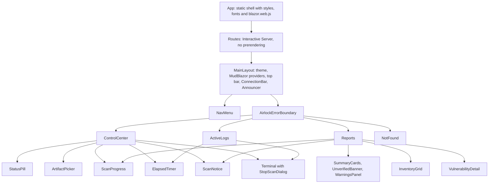
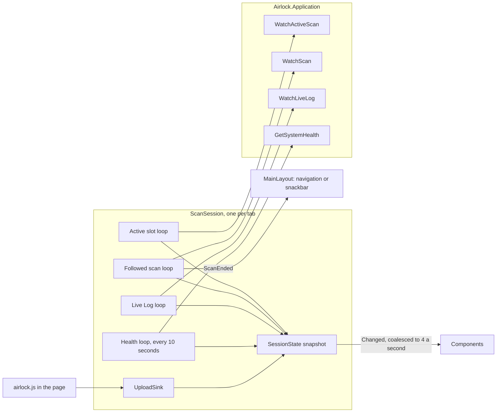

# U5 Web UI — Logical Components

**Stage**: CONSTRUCTION — U5 Web UI — NFR Design (Standard depth)

The UI's additions to `Airlock.Web`, alongside U4's (`u4-web-api/nfr-design/logical-components.md`). Both diagrams were
validated with Mermaid 11.4.1; each has a text alternative.

## Namespaces and files (U5)

| Namespace or folder | Types and files |
|---|---|
| `Airlock.Web.Components` | `App` — the static shell: the head with the stylesheets and fonts, `HeadOutlet`, `Routes` without prerendering, the `#blazor-error-ui` bar and `blazor.web.js`; no `ImportMap`; each page's render mode from `HttpContext.AcceptsInteractiveRouting()`, so the error page is drawn by the server alone (refinement 2). `Routes` — the router with `NotFoundPage` and `FocusOnNavigate` to each page's `h1`. `_Imports`. `AirlockUi` — the UI's registrations and its place in the pipeline |
| `Airlock.Web.Components.Layout` | `MainLayout` — `MudThemeProvider` with `AirlockTheme`, the popover, dialog and snackbar providers, the top bar, `NavMenu`, `ConnectionBar`, `Announcer` and `AirlockErrorBoundary` around the page; it hands `airlock.js`'s fingerprinted address to `AirlockJs` (refinement 5). `NavMenu`, `ConnectionBar`, `Announcer`, `AirlockErrorBoundary`, and `PlainLayout`, the error page's |
| `Airlock.Web.Components.Pages` | `ControlCenter` (`/`), `ActiveLogs` (`/logs`), `Reports` (`/reports/{Id:guid?}`), `NotFound` (`/not-found`), `Error` (`/error`, excluded from interactive routing) |
| `Airlock.Web.Components.Parts` | `SessionComponent`, the base that redraws for chosen kinds of change through the coalescer; then `StatusPill`, `ArtifactPicker`, `ScanProgress`, `ElapsedTimer`, `ScanNotice`, `Terminal`, `StopScanDialog`, `SummaryCards`, `UnverifiedBanner`, `WarningsPanel`, `InventoryGrid`, `VulnerabilityDetail`. Named `Parts`, since CA1716 refuses Visual Basic's keyword `Shared` in a public type's namespace |
| `Airlock.Web.State` | `ScanSession` (scoped: one per circuit), `SessionState`, `SessionChange` (flags), `ScanEnding`, `StagedArtifact`, `UploadProgress`, `TerminalLine`, `InlineNotice`, `NoticeKind`, `SubmissionOutcome` with `SubmissionKind`, `InventoryRow` with `VulnerableRow` and `UnverifiedRow`, `RenderCoalescer`, `UiFormat` |
| `Airlock.Web.Interop` | `AirlockJs` (scoped), `UploadSink`, `StagedFile`, `ScanSubmissionTarget`, `SubmissionAnswer`, `UploadStart` |
| `Airlock.Web.Theme` | `AirlockTheme` |
| `Airlock.Web.Security` | `PageSecurityHeaders` |
| `wwwroot` | `css/airlock.css`, `js/airlock.js`, `fonts/inter/` and `fonts/jetbrains-mono/` with their WOFF2 files and `OFL.txt`, `favicon.svg` |
| `Airlock.Application.UseCases` (U2 amendment) | `UploadLimits` — the reservation's own refusals for the file count and the size, and their size wording, which `ScanReservation` and the page share (UR-08) |

Razor makes every component a public class, so the components and `SessionComponent` are public, with parameters of
public types — the Domain's `Scan`, `Package`, `ScanSummary` — and the session shared as `private protected` members
(refinement 1). Every other type is internal, as in U4; `Airlock.Web.Tests` sees them through `InternalsVisibleTo`.

## Registrations added to `AirlockHost`

Through `AirlockUi.AddAirlockUi`:

| Concern | Registration |
|---|---|
| Razor components | `AddRazorComponents().AddInteractiveServerComponents()`; `CircuitOptions` keep their defaults, with `DetailedErrors` in Development only |
| MudBlazor | `AddMudServices()`, with snackbars at the bottom right: 6 seconds for success and information; errors stay until closed |
| The tab's state | `AddScoped<AirlockJs>()`, `AddScoped<ScanSession>()` |

## The pipeline

In order:

1. `UseAirlockPages`, ahead of U4's branch for `/api`:
   - `PageSecurityHeaders`, which leaves `/api` to U4's headers and sets the CSP everywhere but `/docs` and `/openapi`;
   - outside Development, `UseExceptionHandler("/error", createScopeForErrors: true)`;
   - `UseStatusCodePagesWithReExecute("/not-found", createScopeForStatusCodePages: true)`.

   Not in a branch of their own: re-executing a page needs the application's router, which `WebApplication` withholds
   from branches. Under `/api` the API's problems are written first, inside, so these find nothing left to do, and U4's
   `ApiExceptionHandler` declines exceptions outside `/api`.
2. U4's `UseAirlockApi`, the `/api` branch.
3. `UseAntiforgery()`, which Razor components require; the API's endpoints already opt out (U4 WR-21).
4. `MapStaticAssets()`. `appsettings.json` sets `DisableStaticAssetNotFoundRuntimeFallback`: run from its build output,
   `MapStaticAssets` would otherwise add a `{**path:file}` fallback for GET, which turns the API's 405 for a wrong method
   into 404.
5. U4's endpoints: the API, the OpenAPI document and `/docs`.
6. `MapRazorComponents<App>().AddInteractiveServerRenderMode()`, mapped last (U4 hand-off).

## The component tree

Text alternative:

- `App` is the static shell: styles, fonts and `blazor.web.js`. It renders `Routes` with Interactive Server and no
  prerendering.
- Every page sits in `MainLayout`, which holds the theme, MudBlazor's providers, the top bar, `ConnectionBar`,
  `Announcer` and `NavMenu`, and wraps the page in `AirlockErrorBoundary`.
- `ControlCenter` holds `StatusPill`, `ArtifactPicker`, `ScanProgress`, `ElapsedTimer`, `ScanNotice`, and the
  `Terminal` with its `StopScanDialog`.
- `ActiveLogs` holds `ElapsedTimer` and the `Terminal`.
- `Reports` holds `ScanProgress`, `ScanNotice`, `SummaryCards`, `UnverifiedBanner`, `WarningsPanel`, `InventoryGrid`
  and `VulnerabilityDetail`.
- `NotFound` stands alone.

## The tab's session

Text alternative: each tab's `ScanSession` runs four loops against the Application: the active slot (`WatchActiveScan`),
the followed scan (`WatchScan`), the Live Log (`WatchLiveLog`), and health, read every 10 seconds (`GetSystemHealth`).
Each loop, like the `UploadSink` that `airlock.js` reports uploads to, writes into one immutable `SessionState`
snapshot. The snapshot's `Changed` event reaches the components, which redraw at most four times a second. When the
followed scan ends, the session raises `ScanEnded`, and `MainLayout` navigates to the report or shows a snackbar.

## Checks introduced in U5

| Check | Project | Enforces |
|---|---|---|
| No HTTP from UI types | `Airlock.Architecture.Tests` | No type in `Airlock.Web.Components`, `Airlock.Web.State` or `Airlock.Web.Interop` depends on `HttpClient`; positive control: `Reports` depends on `GetScan` (U5-NFR-01) |
| Public types | `Airlock.Architecture.Tests` | Besides `Program`, only the components and Razor's `_Imports` class are public, all under `Airlock.Web.Components` (refinement 1) |
| Coalesced redraws | `Airlock.Web.Tests` (bUnit) | 100 events within 250 ms of fake time cause at most two renders of a component (U5-NFR-02) |
| Bounds | `Airlock.Web.Tests` (bUnit) | 1,500 lines keep the last 1,000; a disposed session's subscriptions end (U5-NFR-03) |
| Large results | `Airlock.Web.Tests` (bUnit), in the collection that runs alone | A generated scan of 2,000 rows: drawn, filtered and selected within ten times the targets (U5-NFR-04) |
| Uploads | `Airlock.Web.Tests` (bUnit) | Submitting returns at once; progress and the answer arrive through the sink; a page change leaves them flowing (U5-NFR-05) |
| Contrast | `Airlock.Web.Tests` | `ThemeContrastTests` computes every text and background pair of `AirlockTheme` against 4.5:1, and every control part against 3:1 (U5-NFR-07) |
| Accessibility markup | `Airlock.Web.Tests` (bUnit) | Icon buttons named, rows focusable with `aria-selected`, the announcer repeating notices, the terminal's `role="log"` (U5-NFR-07) |
| Page headers | `Airlock.Web.Tests` (`AirlockWebFactory`) | `X-Frame-Options`, the CSP and `nosniff` on `/`, `/logs` and `/reports`; no CSP on `/docs`; U4's headers unchanged on `/api` (U5-NFR-08) |
| External text | `Airlock.Web.Tests` (bUnit) | A description holding `<script>` shows as text (U5-NFR-08) |
| Times | `Airlock.Web.Tests` | `UiFormat` across `Europe/Berlin`'s change on 2026-10-25 and in `America/Phoenix`, under a `de-DE` culture (U5-NFR-09) |
| Logging | `Airlock.Web.Tests` (bUnit) | A failing component logs one error; following a scan logs no UI line at Information (U5-NFR-12) |
| Rules | `Airlock.Web.Tests` | The rule-to-test map of the functional design (UR-01 to UR-41) |
| Manual | The browser pane, at Code Generation and in Build and Test | Uploads and their progress; two tabs; OFFLINE and Reload; keyboard; copying over plain HTTP; exports; reduced motion; the axe-core scan; page weight and start; a full scan with a real NVD key |

## What Code Generation must provide

- **Downloads**, listed with their sizes and fetched only with your permission:
  - MudBlazor 9.11.0 from nuget.org;
  - bUnit (2.13.3, or 2.12.5; Code Generation took 2.12.5) and the packages it brings;
  - the Inter and JetBrains Mono WOFF2 files and licence texts from their GitHub repositories.
- **A U2 amendment**: the Application's `UploadLimits`, which `ScanReservation` then uses for its own refusals.
- **The launch URL** in `launchSettings.json` moves from `/docs` to the UI's `/` (U4 refinement 5).

## Constraints handed to U6

- The container image carries time-zone data and ICU (U5-NFR-09); a `chiseled` image without them would turn every
  browser time zone into UTC.
- The compose file may set the container's host name, which Active Logs shows (UR-21).
- The README credits MudBlazor (MIT) and the fonts (SIL OFL 1.1), and explains that the UI needs WebSockets through any
  reverse proxy.
- CI runs the component tests on Windows and Linux with the API tests.
