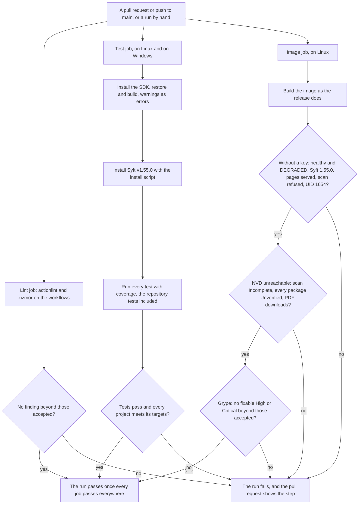
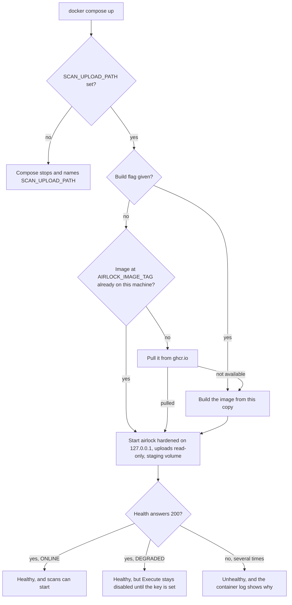
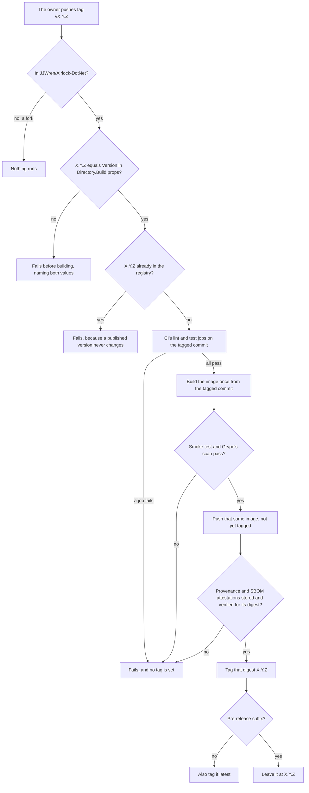

# U6 Delivery — Business Logic Model

**Stage**: CONSTRUCTION — U6 Delivery — Functional Design (Minimal depth)

This document covers three flows: a change through CI, `docker compose up`, and a release. It then maps each rule to
its check, and lists what is left to U6's later stages and to Build and Test. Rules are DR-nn (`business-rules.md`).
The three diagrams were validated with Mermaid 11.4.1, and each has a text alternative. U6's NFR Requirements
(Q-U6-N1 to Q-U6-N4 = A) added the lint job, the real scan in the smoke test, the image scan and the attestations to
the CI and release flows, and the hardening to `docker compose up`. U6's NFR Design took CI's image job out of a
release, whose publishing job builds and tests its one image, and added the attestations' verification before tagging.

## A change through CI

*Text alternative*: A pull request or push to `main`, or a run started by hand, starts three jobs at once. A release
calls only the lint and test jobs, because its publishing job tests the one image it builds (DR-22). The lint job
runs actionlint and zizmor on the workflows, and fails on any finding not accepted with a reason. The test job runs
on Linux and on Windows. It installs the SDK, then restores and builds with warnings as errors. Next it
installs Syft v1.55.0 with the install script and runs every test with coverage, the repository tests included. It
fails unless the tests pass and every project meets its coverage targets. The image job runs on Linux. It builds the
image as the release does and tests it in two phases, under the compose file's settings. Without a key, the
container must become healthy; health must say DEGRADED with Syft 1.55.0; the pages and their stylesheets must be served; a scan must be refused for the missing key;
and the process must run as UID 1654. With NVD unreachable, a scan of `/uploads` must end Incomplete with every package
Unverified, and its PDF must download. Grype then scans the image's SBOM, and the job fails on a fixable High or
Critical vulnerability that is not accepted. A failure in any job fails the run, and the pull request shows which step
failed. The run passes only when every job passes on every platform (DR-11 to DR-14, DR-28, DR-30).

## `docker compose up`

*Text alternative*: `docker compose up` first needs `SCAN_UPLOAD_PATH`. When it is not set, Compose stops and names
it. With `--build`, Compose builds the image from this copy. Without it, Compose uses the image at
`AIRLOCK_IMAGE_TAG` (default `latest`) if this machine already has it. Otherwise it pulls that image from `ghcr.io`.
If the pull fails, for example before the first release, it builds this copy instead. Then the `airlock` container
starts hardened (a read-only root, no capabilities) on `127.0.0.1`, with the scan folder read-only at `/uploads` and
the staging volume mounted. When health answers 200 with ONLINE, the container is healthy and scans can start. When it
answers 200 with DEGRADED, the container is also healthy, but Execute stays disabled until the key is set. When health
fails several times in a row, the container is unhealthy, and its log shows why (DR-07 to DR-10, DR-29).

## A release

*Text alternative*: The release starts when the owner pushes a tag such as `v2.0.0`. In a fork, nothing runs. In
`JJWren/Airlock-DotNet`, the run fails before building unless the tag's version equals `Version` in
`Directory.Build.props`; the failure names both values. It also fails when that version is already in the registry,
because a published version never changes. Next, CI's lint and test jobs run on the tagged commit. If either fails, no
tag is set. When both pass, the publishing job builds the release's one image from the tagged commit, smoke-tests it
and scans it with Grype. When both pass, that same image is pushed, not yet tagged, and its signed provenance and SBOM
attestations are stored for its digest and verified as a user would verify them. If they cannot be stored or do not
verify, no tag is set. Only then is that digest tagged `X.Y.Z`. A version without a pre-release suffix is also tagged
`latest`; a pre-release keeps only its own tag (DR-19 to DR-23, DR-30, DR-31).

## Rules to checks

| Rule | Checked by | When |
|---|---|---|
| DR-01 | A run from a fresh clone on Windows: the install script, the user-secrets key, `dotnet run`, ONLINE | Build and Test (E14 "Run locally on Windows") |
| DR-02 | The image job: Syft 1.55.0 in health, pages served in Production. `docker image inspect` for the user, the port, `URLS` and the cleared `ASPNETCORE_HTTP_PORTS`. A repository test for the runtime `FROM` | Every CI run; Code Generation |
| DR-03 | The image job: the process runs as UID 1654, and a scan's staging works under a read-only root. Writing to the application folder fails | Every CI run; Code Generation |
| DR-04 | A repository test: the scripts, the `Dockerfile` and the README name one version, and each script carries a SHA-256 for every archive it can fetch. The integration test `The_status_comes_from_the_probe` checks the installed Syft | Every test run |
| DR-05 | A repository test: every package a `src/` project uses is in the notices. The image holds `LICENSE`, the notices and Syft's licence | Every test run; Code Generation |
| DR-06 | The build context's file list and the image's files: no `.env`, `.git`, source code or `syft.exe` | Code Generation |
| DR-07 | The image job starts the service from the compose file; `docker compose config` shows the resolved settings | Every CI run; Code Generation |
| DR-08 | `docker compose config` without `SCAN_UPLOAD_PATH` fails, naming it | Code Generation |
| DR-09 | A repository test: `.env.example` names every variable the compose file reads, and `.env` is in `.gitignore` and `.dockerignore` | Every test run |
| DR-10 | The image job waits for `healthy`. A container listening on another port turns unhealthy | Every CI run; Code Generation |
| DR-11, DR-14 | The lint job (actionlint and zizmor) on every run, and the same tools run locally at Code Generation (downloads need your permission); their first real run after your push | Code Generation; every CI run after the push |
| DR-12 | The coverage gate run locally against the current reports, as CI runs it | Code Generation |
| DR-13 | The smoke test's script, both phases, run locally against the built image, as CI runs it | Code Generation; every CI run |
| DR-15, DR-16 | Syntax checks; a repository test for `dependabot.yml`'s ecosystems, groups, cooldown and LTS rule; GitHub validates CodeQL's and Dependabot's files on the first push | Code Generation; after the push |
| DR-17 | Every README claim reviewed against the code, the tests and Build and Test's results; its commands run as written | Code Generation; Build and Test |
| DR-18 | A repository test: the README states MIT, QuestPDF's Community licence and its threshold, and the NVD notice | Every test run |
| DR-19 to DR-21 | The version check run locally against a matching and a mismatching tag; syntax checks; the first real run on your first tag | Code Generation; the first release |
| DR-22 to DR-25 | Syntax checks; a repository test for the publishing job's step order and permissions. Every release checks that the pushed image's ID is the tested one's and that its tags name the attested digest. On the first release: the package's tags and labels, and the README's steps followed as written | Every test run; every release; the first release |
| DR-26 | No push command is run, and the audit log records every commit | Throughout |
| DR-27 | zizmor's SHA rule in the lint job; a repository test that every `FROM` has a digest and every CI tool a checksum or digest | Every CI run; every test run |
| DR-28 | The lint job itself; a repository test that every `uses:` is GitHub's own | Every CI run; every test run |
| DR-29 | A repository test for compose's hardening settings; the smoke test's scan runs under them | Every test run; every CI run |
| DR-30 | The image job's scan, in CI and in the release; a repository test for `.grype.yaml`'s entries and their review dates | Every CI run; every test run |
| DR-31 | A repository test for the attestation steps and their permissions; every release verifies both before tagging; on the first release, `gh attestation verify` as the README shows it | Every test run; every release; the first release |

### Stories

| Scenario | Rules | Where it is shown |
|---|---|---|
| E14 "Run locally on Windows" | DR-01 | Build and Test, with a real key |
| E14 "Run with Docker Compose" | DR-07 to DR-10, DR-29 | Build and Test: `docker compose up --build` with a real key, ONLINE, and a scan of `/uploads` (U6's unit test). CI scans `/uploads` with NVD unreachable (DR-13) |
| E14 "Same results on both platforms" | DR-02, DR-04 | Build and Test |
| E15 "Pull requests are verified" | DR-11 to DR-14, DR-28, DR-30 | CI's first run after your push |
| E15 "Code scanning" | DR-15 | CodeQL's first run after your push |
| E15 "Licensing is documented" | DR-18 | A repository test |
| E15 "A published image can be verified" | DR-31 | The first release: `gh attestation verify` |

## Left to U6's later stages

**NFR Requirements (Standard)** — settled (`../nfr-requirements/`): the chiseled runtime image (Q-U6-N1), the image
scan (Q-U6-N2), attestations (Q-U6-N3), pinning with Dependabot's cooldown (Q-U6-N4), the container's hardening, the
budgets and the real scan in the smoke test — U6-NFR-01 to U6-NFR-18, with DR-27 to DR-31 here.

**NFR Design (Minimal)** — settled (`../nfr-design/`): the patterns, among them committed checksums, one image per
release verified before it is tagged, the smoke test through the compose file, Grype's policy in `.grype.yaml`, the
data-protection keys on the volume, and the LTS rule for Dependabot.

**Infrastructure Design (Standard)** — settled (`../infrastructure-design/`; Q-U6-I1 = A): the SDK's 4xx band; the
pins; the image's stages, paths and settings; the probe; compose; the three workflows; building, pushing by digest,
attesting and tagging; the scan; the smoke test; the CI tools' images; Dependabot and zizmor; no caching; the
scripts; the repository tests; the coverage checker. Compose is expected to build this copy when a pull fails before
the first release. Code Generation confirms it; if it does not, the README says to use `--build`.

## Handed to Build and Test

- E14's three scenarios with a real key: `dotnet run` ONLINE on Windows; `docker compose up --build` ONLINE with a scan
  of `/uploads`; the same packages and findings on Windows and in the container.
- The live NVD test (`AIRLOCK_LIVE_NVD=1`) and a full scan with a real key (Q-U6-1 = A).
- Stopping the container during a scan, then finding no staging folder after the next start (U6-NFR-11); Reports
  converting times to the browser's time zone with Airlock in the container (U6-NFR-08); the quick start from a fresh
  clone (U6-NFR-18).
- CI's first run and the first release, once you create the repository and push. Neither happens before.
