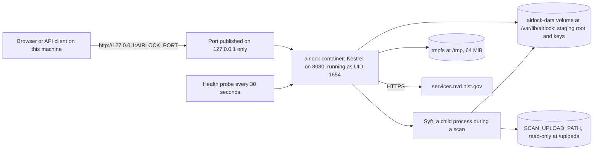
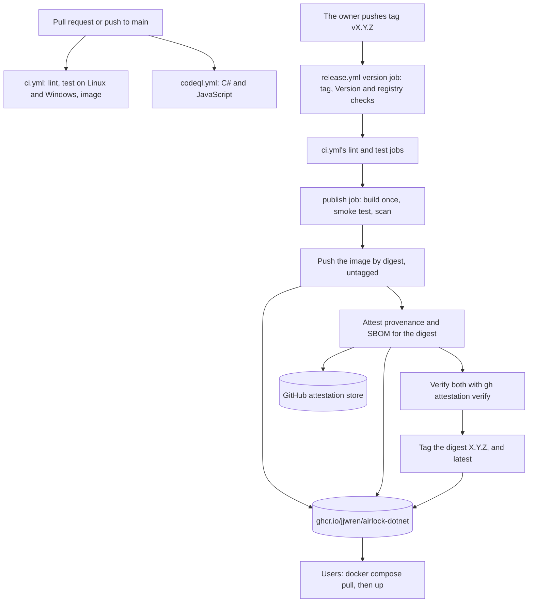

# U6 Delivery — Deployment Architecture

**Stage**: CONSTRUCTION — U6 Delivery — Infrastructure Design (Standard depth)

Where Airlock and its delivery run, what each place holds, what it talks to, and with which identity. The settings
behind it are in `infrastructure-design.md`. U4's `../../u4-web-api/infrastructure-design/deployment-architecture.md`
describes the application itself: its port, its configuration and its single process.

## The places

| Place | Runs | Holds | Identity |
|---|---|---|---|
| A developer's machine | `dotnet run`, the tests, the smoke test and the image scan against a local build | SDK 10.0.403, Syft in `bin/` from the install script, Docker for the image, the NVD key in user-secrets | The developer |
| A user's Docker host | `docker compose up`: the published image, or this copy built with `--build` | `.env` with the NVD key; the folder in `SCAN_UPLOAD_PATH`; the `airlock-data` volume | The container's `app` user, UID 1654 |
| GitHub-hosted runners | `ci.yml`, `codeql.yml` and `release.yml` (`ubuntu-24.04`, `windows-2025`) | Only what each run checks out, builds and downloads. Nothing survives the run except its artifacts, kept 14 days | Each job's `GITHUB_TOKEN`, with that job's permissions; the publish job's OIDC token |
| GHCR | `ghcr.io/jjwren/airlock-dotnet` | The published images, their tags, and their attestations as referrers | The owner, who sets the package's visibility |
| GitHub's attestation store | — | The signed provenance and SBOM of each published digest | — |

## The running container

*Text alternative*: A browser or API client on the same machine reaches Airlock at `http://127.0.0.1` on
`AIRLOCK_PORT`, which is published on 127.0.0.1 only. Inside the container Kestrel listens on 8080 as UID 1654, and the
image's health probe asks it every 30 seconds. During a scan Kestrel starts Syft as a child process. Syft reads the
host folder `SCAN_UPLOAD_PATH`, mounted read-only at `/uploads`. Both write to the `airlock-data` volume at
`/var/lib/airlock`, which holds the staging root and the data-protection keys. A small tmpfs serves `/tmp`. Airlock's
only outbound connection is HTTPS to `services.nvd.nist.gov`.

### Its filesystem

| Path | Owner | Writable | Backed by |
|---|---|---|---|
| `/app` (Airlock, `bin/syft`, the notices) | root | No | The image |
| `/var/lib/airlock/staging` | UID 1654 | Yes | The `airlock-data` volume |
| `/var/lib/airlock/keys` | UID 1654 | Yes | The `airlock-data` volume |
| `/uploads` | The host folder's owner | No | A read-only bind mount of `SCAN_UPLOAD_PATH` |
| `/tmp` | root, mode 1777 | Yes | tmpfs, 64 MiB, `noexec` |
| Everything else | root | No | The image, read-only under compose |

The folder behind `/uploads` must be readable by UID 1654. A folder that any user can read works as it is; the README
says what to do when the folder is private.

### Starting, stopping and restarting

- **Start.** Docker runs its init process, which starts `/usr/bin/dotnet /app/Airlock.Web.dll`. Airlock then:
  - takes the staging root's lock;
  - sweeps any scan folder that a crash left (U4-NFR-09);
  - listens on 8080.

  The health check starts after 2 seconds and is retried every 2 seconds during the 30-second start period, so the
  container reports healthy within a few seconds.
- **Stop.** `docker compose stop` sends SIGTERM through the init process. Airlock cancels a running scan, kills Syft's
  process tree, deletes the scan's folder and releases the lock, inside Docker's 10-second grace period (U4).
- **Restart.** `restart: unless-stopped` brings the container back after a crash or a reboot. The keys on the volume
  stay, so browsers keep their cookies; any open tab reloads, as its circuit ended with the old process.
- **Data.** The volume outlives the container. `docker compose down -v` removes it, with its keys and any leftover
  staging. Airlock keeps no scan results on disk: finished scans stay in memory for 24 hours, at most 20 (N1), and end
  with the process.

## From a change to a published image

*Text alternative*:
- **CI.** A pull request or a push to `main` starts two workflows. `ci.yml` runs the lint job, the test job on Linux
  and Windows, and the image job. `codeql.yml` analyses C# and JavaScript.
- **The release.** When the owner pushes a tag such as `v2.0.0`, the release's version job checks the tag against
  `Version` and the registry. `ci.yml`'s lint and test jobs then run on the tagged commit. The publish job builds the
  image once, smoke-tests it and scans it.
- **Publishing.** The publish job pushes the image by its digest, untagged, to `ghcr.io/jjwren/airlock-dotnet`. It
  stores signed provenance and SBOM attestations for that digest, in GitHub's attestation store and beside the image
  in GHCR. It then verifies both with `gh attestation verify`. Only then is the digest tagged `X.Y.Z`, and `latest`
  for a version without a pre-release suffix.
- **Users** get it with `docker compose pull` and `docker compose up`.

## What each job talks to

| Job | Downloads from | Writes to |
|---|---|---|
| lint | Docker Hub (actionlint), `ghcr.io` (zizmor), the GitHub API (zizmor's online audits) | The run's annotations |
| test | nuget.org (restore and NuGet's audit), github.com (Syft's release) | The run's artifacts and summary |
| image | `mcr.microsoft.com` (the .NET images), `ghcr.io` (Syft, Grype), Docker Hub (BuildKit), nuget.org (the image's restore), Anchore's database server (Grype) | The run's artifacts and summary |
| CodeQL | nuget.org; GitHub's CodeQL bundle | The repository's code-scanning alerts |
| version | `ghcr.io` (does `X.Y.Z` exist?) | — |
| publish | As the image job | `ghcr.io` (the image, its tags, the attestations as referrers); GitHub's attestation store; Sigstore's public-good instance, through `actions/attest` |

None of them talks to NVD: CI has no key (Q-U6-1).

## Identities and secrets

| Who | Holds | Can |
|---|---|---|
| Each CI job | Its own `GITHUB_TOKEN`, `contents: read` | Read the repository |
| CodeQL's job | Its token, plus `security-events: write` and `actions: read` | Upload code-scanning results |
| The version job | Its token, plus `packages: read` | Read GHCR |
| The publish job | Its token, plus `packages: write`, `id-token: write` and `attestations: write` | Push to GHCR, obtain a Sigstore certificate for the release workflow, and store attestations |
| The smoke test | The canary key, written in the script | Nothing: NVD is unreachable in that phase |
| A user | Their NVD key in `.env` | Read NVD through Airlock |

No workflow reads a repository secret, and none writes to the repository (DR-26).

## When something fails

| Failure | What happens | Recovery |
|---|---|---|
| A Docker Hub pull (actionlint or BuildKit) | The job fails before it checks anything | Run the job again |
| Grype's database is more than five days old | The scan fails (fail closed) | Run the job again once Anchore's feed has caught up |
| An accepted finding's review date passes | The repository test fails on every run | Renew the acceptance with a reason and a new date, or remove it |
| A release step after the push | The digest stays in GHCR untagged and names no version | Fix the cause and push the tag again, or re-run the workflow; the owner may delete the untagged version in GitHub |
| A Dependabot proposal for Syft's image alone | DR-04's test fails | Update the scripts, their hashes, the README and the integration tests in the same pull request |
| A Dependabot proposal for `global.json` before the SDK image | The image job fails, since the build's SDK is older | Merge the SDK image's proposal first |
| The first `docker compose up`, before any release | The pull fails, and Compose builds this copy instead | None needed; or use `--build` if Compose does not fall back |
