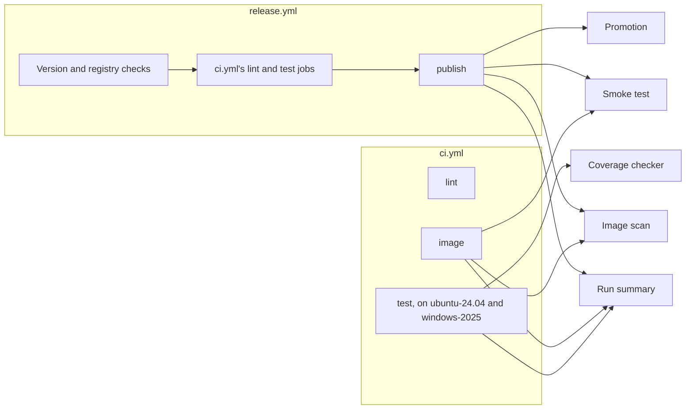

# U6 Delivery — Logical Components

**Stage**: CONSTRUCTION — U6 Delivery — NFR Design (Minimal depth)

The pieces that `nfr-design-patterns.md` adds to the files in `../functional-design/domain-entities.md`, how the
workflows share them, and the checks U6 introduces. The names are logical: Infrastructure Design fixes the paths,
languages and values.

## Pieces added by this design

| Piece | What it does | Used by | For |
|---|---|---|---|
| Smoke test | Starts the built image through `docker-compose.yml` and the smoke override. Runs the keyless phase, then the phase with NVD unreachable, and checks the log's warnings against the expected list. On a failure it prints the container's log; it always removes the container and its volume | CI's image job, the publishing job, a developer | U6-NFR-05, U6-NFR-11, U6-NFR-12, U6-NFR-16 |
| Smoke override | A compose file that only the smoke test uses. It sets the built image and the folder behind `/uploads`; for the second phase it adds the canary key and `Nvd:BaseUrl` at a closed port on 127.0.0.1 | The smoke test | U6-NFR-12 |
| Image scan | Syft makes the SBOM of the built image. Grype reads it under `.grype.yaml`, writes its JSON report, then gives its verdict | CI's image job, the publishing job, a developer | U6-NFR-06 |
| Promotion | Pushes the tested image without a tag, attests the provenance and the SBOM, verifies both, then tags the digest and checks the tags | The publishing job | U6-NFR-07 |
| Run summary | Writes the run summary from the jobs' results: the tests per project, coverage against the targets, the image's compressed size, Grype's counts by severity and fix state, and the accepted findings | The test, image and publishing jobs | U6-NFR-13, U6-NFR-16 |
| Coverage checker | Reads the Cobertura reports against the targets in `domain-entities.md` | The test job, a developer | DR-12 |
| Tool pins | Each CI tool's version, with its SHA-256 or digest committed here and checked before the tool runs | Every job that fetches a tool | U6-NFR-01, U6-NFR-15 |
| Expected start warnings | The warnings a clean start may log, each with the README section that explains it. At first, the one ASP.NET Core logs when it creates a data-protection key | The smoke test, a repository test | U6-NFR-16 |
| The keys' folder | Where ASP.NET Core keeps its data-protection keys: on the volume, beside the staging root | Airlock in the container | U6-NFR-09 |

`ci.yml` takes one input from a caller: whether to run its image job. `release.yml` turns it off.

## How the workflows share them

*Text alternative*: `ci.yml` has three jobs: lint, test (on `ubuntu-24.04` and `windows-2025`) and image.
`release.yml` runs its version and registry checks, then calls only the lint and test jobs of `ci.yml`, then runs
its publish job. The test job runs the coverage checker. The image job and the publish job both run the smoke test and
the image scan; only the publish job runs the promotion. The test, image and publish jobs each write their part of the
run summary. Every job that fetches a tool does so through the tool pins. `codeql.yml` stands apart and shares none of
these pieces.

## Checks introduced in U6

| Check | Runs in | Enforces |
|---|---|---|
| actionlint | lint | Workflow syntax, expressions and runner labels. With the shellcheck that the runner carries, it also checks every `run:` script |
| zizmor, online with the job's read-only token | lint | SHA pins; GitHub's own actions only; permissions, checkout credentials, template injection, triggers and caches in a release; impostor commits; actions with known advisories; Dependabot's cooldown |
| Repository tests | test, on both runners | DR-04, DR-05, DR-09 and DR-18; U6-NFR-01 to U6-NFR-03, U6-NFR-05 to U6-NFR-10, U6-NFR-15 and U6-NFR-16. Among them: every job's time limit; the concurrency groups; the release's guards and step order; the smoke override's keys; no inline zizmor ignores; the review dates; the LTS rule; a runtime stage without `RUN`; and a README that explains every expected warning |
| Coverage checker | test, on both runners | DR-12's targets |
| Smoke test | image, publish | U6-NFR-05, U6-NFR-08, U6-NFR-09, U6-NFR-11, U6-NFR-12, U6-NFR-16 |
| Grype under `.grype.yaml` | image, publish | U6-NFR-06 |
| The promotion's checks | publish | The pushed image is the tested one, both attestations verify, and the tags name the attested digest (U6-NFR-07) |

## Left to Infrastructure Design

Settled in `../infrastructure-design/`. In addition to the list in `../nfr-requirements/nfr-requirements.md`:

- how the push leaves the image untagged, and how the tags are added without writing a new manifest;
- how the keys' folder is set: a setting Airlock reads, or a mount that puts ASP.NET Core's default folder for `app` on
  the volume;
- how the CI tools are pinned so that Dependabot can still update them, for example as tool images by digest;
- the scripts' language, and where the smoke override and the list of expected warnings live;
- the canary key's value, and the closed port;
- the name of `ci.yml`'s input that turns off its image job.
