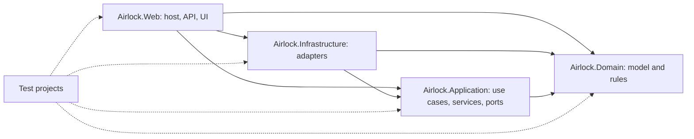
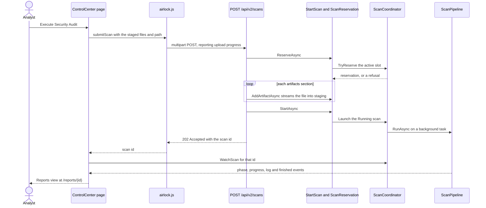
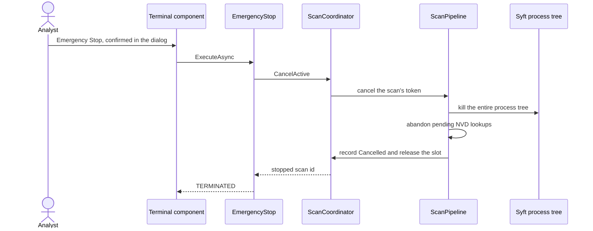
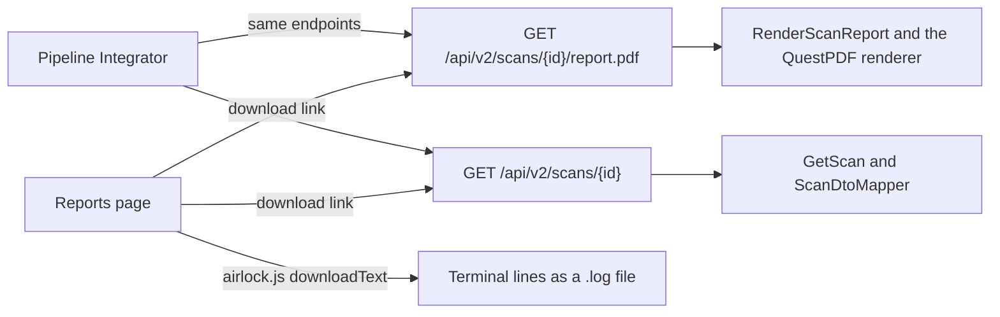

# Component Dependencies

**Stage**: INCEPTION — Application Design (Standard depth)

## Project references

Text alternative: Airlock.Web references Infrastructure, Application and Domain. Infrastructure references
Application and Domain. Application references Domain only. Domain references nothing. Each test project references
the layer it tests (API and component tests reference Web).

## Allowed dependencies

| Project | Airlock references | Packages |
|---|---|---|
| Airlock.Domain | — | None (base class library only) |
| Airlock.Application | Domain | Microsoft.Extensions.Logging.Abstractions, Microsoft.Extensions.Options, Microsoft.Extensions.DependencyInjection.Abstractions |
| Airlock.Infrastructure | Application, Domain | Microsoft.Extensions.Http.Resilience, QuestPDF, Microsoft.Extensions.Options.ConfigurationExtensions, Microsoft.Extensions.Hosting.Abstractions (System.Threading.RateLimiting ships with the shared framework) |
| Airlock.Web | Infrastructure, Application, Domain | ASP.NET Core shared framework, MudBlazor, Microsoft.AspNetCore.OpenApi, Scalar.AspNetCore |
| Test projects | The layer under test | xunit.v3, NSubstitute, bunit, Microsoft.AspNetCore.Mvc.Testing, TngTech.ArchUnitNET.xUnitV3 |

## Architecture rules (enforced by Airlock.Architecture.Tests)

1. Airlock.Domain depends on no other Airlock project and on no `Microsoft.*` namespace.
2. Airlock.Application depends on Airlock.Domain only (plus the allowed abstractions) — never on Infrastructure, Web
   or `Microsoft.AspNetCore.*`.
3. Airlock.Infrastructure never depends on Airlock.Web.
4. Port interfaces live in Airlock.Application and are implemented only in Airlock.Infrastructure.
5. API endpoints and UI components call Application use cases; they never use Infrastructure types directly (only
   `Program` wires them).
6. Use cases are sealed classes in the `Airlock.Application.UseCases` namespace.

## Runtime interactions

### Submit and run a scan from the UI

Text alternative: the analyst presses Execute; the page asks `airlock.js` to post the staged files and the path to
`POST /api/v2/scans` while reporting upload progress. The endpoint reserves the single active slot through
`StartScan` (or returns a refusal), streams each artifact into the staging area, then starts the scan, which the
coordinator runs on a background task. The endpoint answers 202 with the scan id; the page subscribes to that scan's
events in-process and, when it finishes, shows the Reports view at `/reports/{id}`.

### Emergency Stop

Text alternative: after the confirmation dialog the Terminal calls `EmergencyStop`, which asks the coordinator to
cancel the active scan. The pipeline sees its token cancelled, kills the Syft process tree, abandons pending NVD
lookups, records the scan as Cancelled and releases the slot; the Terminal reports TERMINATED.

### Exports

Text alternative: Export PDF and Export JSON on the Reports page are plain download links to the same API endpoints
the Pipeline Integrator uses, which render the PDF through `RenderScanReport` and serialize the scan through
`GetScan` and `ScanDtoMapper`. Export Logs saves the tab's terminal lines through `airlock.js`.

## ADR-0001 refinement (accepted 2026-10-21)

ADR-0001 originally let the UI use HTTP only for scan submission. This design also routes Export PDF and Export JSON
through the API as plain download links, so the UI and the API serve byte-for-byte the same files (E11) from one
implementation. Everything live — progress, the Live Log, results on screen, cancellation — stays in-process.
Accepted with Application Design; ADR-0001 now says so.
