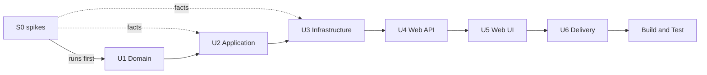

# Unit Dependencies

**Stage**: INCEPTION — Units Generation (Standard depth)

## Sequence

Text alternative: the S0 spikes run first and feed their findings into U2 Application and U3 Infrastructure. The
units are then built strictly in order — U1 Domain, U2 Application, U3 Infrastructure, U4 Web API, U5 Web UI, U6
Delivery — followed by Build and Test.

## Dependency matrix

| Unit | Needs from earlier units | Gives to later units |
|---|---|---|
| S0 | — | Syft per-artifact behaviour and NVD semantics (U2, U3) |
| U1 Domain | — | Domain types and rules (U2–U5) |
| U2 Application | U1 | Ports (U3), use cases and refusal codes (U4, U5) |
| U3 Infrastructure | U1, U2 | Adapters, options and `AddAirlockInfrastructure` (U4) |
| U4 Web API | U1–U3 | Host, `/api/v2` endpoints for submission and downloads (U5) |
| U5 Web UI | U1–U4 | The finished application (U6) |
| U6 Delivery | U1–U5 | Image, compose, CI (Build and Test) |

## Contracts frozen at the end of each unit

| After | Frozen contract |
|---|---|
| U1 | Domain type names and shapes |
| U2 | Port interfaces, use-case signatures, `RefusalCode` values, the `ScanEvent` family |
| U3 | Configuration keys and environment-variable names; the registration extension |
| U4 | The HTTP contract: routes, JSON shapes, SSE event names, ProblemDetails mapping (captured in the OpenAPI document) |
| U5 | UI routes and the `airlock.js` module contract |
| U6 | Image layout, compose variables, CI workflow names |

If a later unit needs to change a frozen contract, the change is raised as a question in that unit's Functional
Design; on approval the earlier unit's documents and code are updated in the same unit and the change is logged in
`audit.md`.

## Risks along the chain

| Risk | Affects | Mitigation |
|---|---|---|
| S0 shows Syft cannot catalog some artifact class as a single file (for example `.nupkg` or `.whl`) | D4 intake design in U2, staging in U3 | Raised as a question before U1: unpack that class in Airlock, or document it as unsupported |
| NVD signals an unknown `cpeName` as an error status rather than an empty result | `CatalogLookup` mapping in U3, correlation semantics in U2 | S0 records the exact response; U3 maps it to NoRecords; U2 is written against the port's three outcomes, not HTTP codes |
| MudBlazor 9 behaviour on .NET 10 | U5 | Package targets net10.0 (verified 2026-10-20); version pinned centrally |
| QuestPDF Community licence terms | U3, U6 README | Documented in README; renderer isolated behind `IScanReportRenderer` |
| A late change to the HTTP contract after U4 | U5, external clients | OpenAPI document reviewed at the U4 Code Generation checkpoint |
