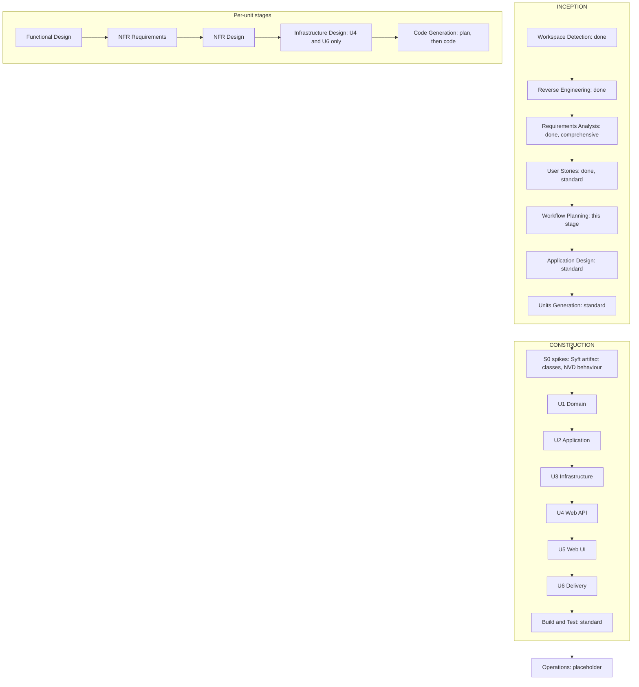

# Workflow Planning

**Stage**: INCEPTION — Workflow Planning
**Started**: 2026-10-21T00:41:37Z
**Path**: Full (decision N8) — every stage runs; depth adapts to how much each unit actually has to decide.
Every recommendation below can be overridden.

## Checklist

- [x] Load prior context: reverse engineering, intent analysis, requirements (FR-01…FR-31, NFR-01…NFR-12),
      user stories (E01–E15), GLOSSARY.md, ADR-0001…0005
- [x] Decide which stages execute
- [x] Set the depth of each stage, per unit
- [x] Sequence the units of work
- [x] Generate and validate the workflow visualization
- [x] Approval (approved as proposed, 2026-10-21T00:48:27Z)

## Depth scale

- **Minimal** — one short document holding only the decisions specific to that unit; nothing restated from earlier
  artifacts.
- **Standard** — the stage's full set of documents at normal detail.
- **Comprehensive** — the full set plus worked examples, edge-case tables and an explicit mapping to tests; used
  where the original's defects clustered (correlation, Syft and NVD handling) and for the largest code units.

## INCEPTION

| Stage | Plan | Depth | Why |
|---|---|---|---|
| Workspace Detection | Done | — | Greenfield target, brownfield source |
| Reverse Engineering | Done | — | Approved in requirements round 1 (Q4) |
| Requirements Analysis | Done | Comprehensive | Approved with the plan |
| User Stories | Done | Standard | 3 personas, 15 epics; approved |
| Workflow Planning | This stage | Standard | — |
| Application Design | Execute | Standard | Four projects with ports between them; components, methods, services and their dependencies must be pinned before units are cut. Starts from the approved target layout. |
| Units Generation | Execute | Standard | Six units, their dependencies, and the story map (E01–E15 → U1–U6). |

## CONSTRUCTION

**Prelude — S0 spikes** (before U1). Verify, outside the product code, the two behaviours the design depends on:
Syft v1.55.0 against one sample per artifact class (manifest, lock file, `.jar`, `.whl`, `.nupkg`, `.zip`,
`.tar.gz`, `docker save` tarball, Go binary, .NET assembly), and NVD's answers to an unknown `cpeName` and to
throttling. Results go to `construction/spikes/spike-results.md`. Running them means downloading the official
Syft v1.55.0 release from `github.com/anchore/syft` (checksum-verified); I will ask before downloading. If a result
contradicts a requirement — for example Syft not reading `.nupkg` files — I bring it back as a question before U1.

**Per-unit stages**

| Unit | Functional Design | NFR Requirements | NFR Design | Infrastructure Design | Code Generation |
|---|---|---|---|---|---|
| U1 Domain | Standard | Minimal | Minimal | Skip — no infrastructure | Standard |
| U2 Application | Comprehensive | Standard | Standard | Skip — no infrastructure | Comprehensive |
| U3 Infrastructure | Comprehensive | Standard | Standard | Skip — external services are mapped in U4 and U6 | Comprehensive |
| U4 Web API | Standard | Standard | Standard | Minimal | Standard |
| U5 Web UI | Standard | Standard | Standard | Skip — no infrastructure | Comprehensive |
| U6 Delivery | Minimal | Standard | Minimal | Standard | Standard |

**What each unit's design stages settle**

- **U1 Domain** — Functional: the entities and value objects (Scan with its status transitions, Scan Target, Artifact,
  Manifest, Package identity, Candidate CPE, CVE, CVSS score with version, Severity, Finding, Match Method, Scan
  Summary) and the rules they own (CVSS precedence, highest severity, threshold, summary invariant
  total = clean + vulnerable + unverified). NFR: no dependencies, immutability, determinism.
- **U2 Application** — Functional: the use cases (StartScan, CancelScan, EmergencyStop, GetScan, RenderScanReport,
  GetSystemHealth), the scan pipeline's phases, the correlation algorithm as decision tables (CPE resolution, keyword
  verification, Unverified marking), the single-active-scan guard, retention, progress events, and the port
  contracts — with worked examples from the original's tests and the `mockData.js` false positives. NFR: bounded
  parallelism, cancellation propagation, the 60-minute cap, fail-closed guarantees, scan-scoped logging.
- **U3 Infrastructure** — Functional: Syft invocation and JSON mapping (including candidate-CPE sources), process-tree
  termination, NVD request/response mapping (CVSS v3.1 → v3.0 → v4.0 → v2, product extraction for keyword
  verification, how "no record" differs from "lookup failed"), staging layout and name sanitization, the QuestPDF
  layout, the in-memory registry, the live-log broadcaster. NFR: retries with backoff and `Retry-After`, the
  50-per-30-seconds limiter, timeouts, secrets never logged, Windows and Linux process handling, bounded buffers.
- **U4 Web API** — Functional: endpoint contracts, camelCase DTOs, status codes, ProblemDetails types, the SSE event
  schema, the multipart contract, the health JSON. NFR: streaming 2 GB uploads without buffering, request limits,
  antiforgery off for the API, OpenAPI completeness, no internal details in errors. Infrastructure: Kestrel and
  per-endpoint limits, ports, configuration sources and precedence, health-check wiring.
- **U5 Web UI** — Functional: page and component inventory with their states, the per-browser-tab scan session,
  interactions (execute, stop, rescan, filter, select, export), the `airlock.js` contract (upload with progress,
  download, clipboard, browser time zone), the MudBlazor theme and the on-screen copy. NFR: keyboard access and text
  severity badges, responsiveness during scans, OFFLINE on circuit loss, time-zone correctness, grid and terminal
  performance.
- **U6 Delivery** — Functional: what the install scripts, CI workflows and compose file do. NFR: pinned versions,
  checksum-verified Syft download, least-privilege CI tokens, container hardening, documented licensing.
  Infrastructure: Dockerfile stages and base images, the `/uploads` and staging volumes, compose environment mapping,
  CI runners, CodeQL and Dependabot configuration.

**Build and Test** — Standard: all five instruction files (build, unit, integration, performance, summary), covering
Syft integration tests, API integration tests, NVD limiter compliance, a large-upload check, security checks (path
traversal, error bodies) and an end-to-end pass in the browser pane.

**Operations** — placeholder, not executed.

## Change sequence

U1 → U2 → U3 → U4 → U5 → U6, strictly in order. Dependencies point inward (Clean Architecture), each unit compiles
and is tested against the ones before it, the UI needs the API's scan-submission endpoint (N2), and Delivery
packages the finished application. No units run in parallel: each stage ends at an approval checkpoint.

**Source control**: one feature branch per unit (`feature/u1-domain` … `feature/u6-delivery`). I commit only when you
say so, and nothing is pushed until the GitHub repository exists and you approve.

**Checkpoints**: about 35 approvals in total — Application Design, Units Generation, possibly one after S0, five per
unit (six for U4 and U6, which add Infrastructure Design; Code Generation has a plan approval and a completion
approval), and Build and Test.

## Workflow visualization

Text alternative: INCEPTION runs Workspace Detection, Reverse Engineering, Requirements Analysis and User Stories
(all done), then Workflow Planning (this stage), Application Design and Units Generation. CONSTRUCTION starts with the
S0 spikes, then builds U1 Domain, U2 Application, U3 Infrastructure, U4 Web API, U5 Web UI and U6 Delivery in that
order, and ends with Build and Test. Each unit goes through Functional Design, NFR Requirements, NFR Design,
Infrastructure Design (U4 and U6 only) and Code Generation (a plan approval, then the code). Operations is a
placeholder.
