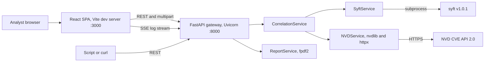
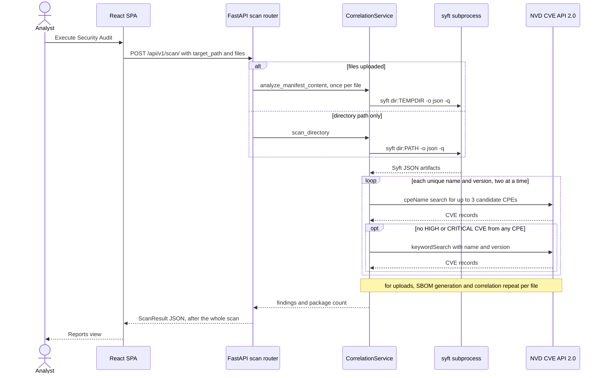
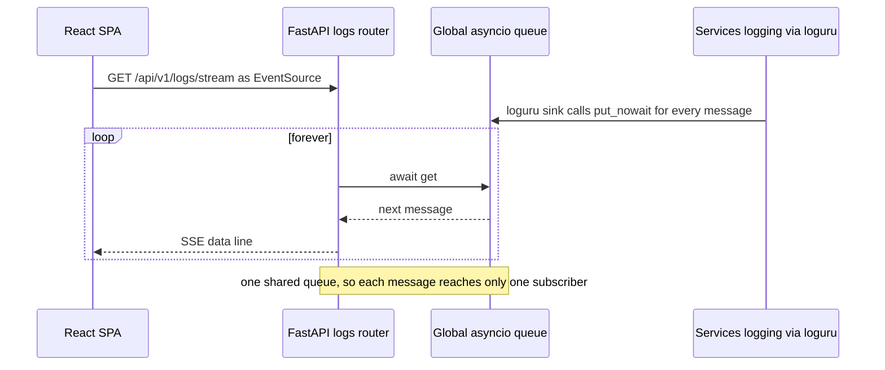
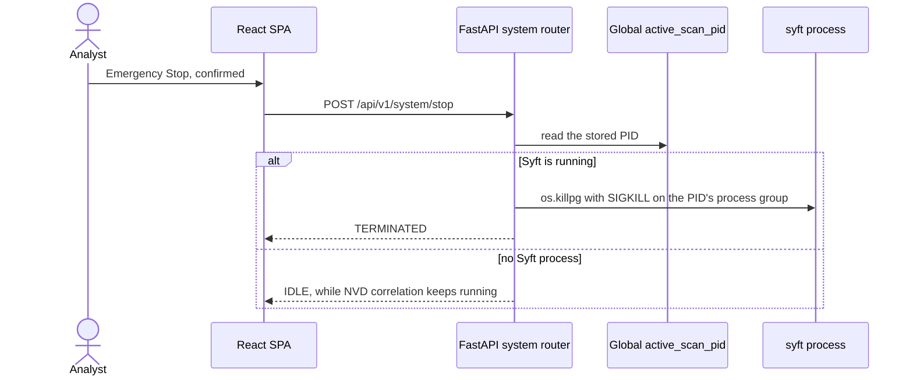
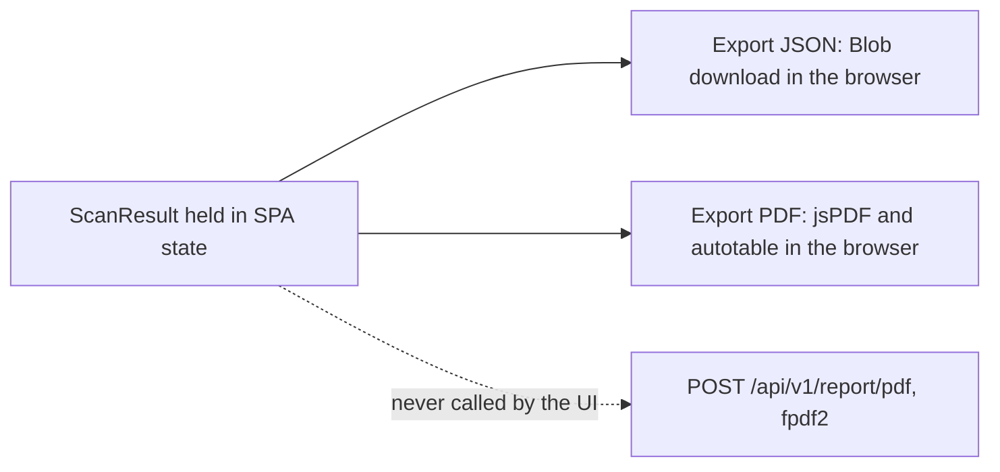

# Architecture — Original Airlock (Python / React)

Source: `JJWren/Airlock` @ `0a62ba3` (master, 2026-08-28). Everything here describes the system being rebuilt, not the
.NET target.

## Business overview

Airlock is a "digital airlock": a gateway that checks third-party software before it is admitted into a controlled
environment, framed against NIST SP 800-53 CM-8 (component inventory) and SI-2 (flaw remediation) and Executive
Order 14028. It performs **Software Composition Analysis (SCA)**: it inventories the third-party packages inside a
target (an SBOM produced by Anchore Syft) and correlates each package with CVE records from the NIST National
Vulnerability Database (NVD). It does not analyze first-party source code (it is not a SAST tool).

### Business transactions

| # | Transaction | Actor | Outcome |
|---|---|---|---|
| BT-1 | Scan a directory | Analyst (UI) or script (API) | ScanResult for the packages found under a host or container path |
| BT-2 | Scan uploaded manifests | Analyst (UI) or script (API) | ScanResult for uploaded `.txt` / `.json` dependency files |
| BT-3 | Watch the live log | Analyst (UI) | Real-time log lines while scans run |
| BT-4 | Emergency Stop | Analyst (UI) or script (API) | The running Syft process group is killed |
| BT-5 | Review results | Analyst (UI) | Summary cards, filterable inventory, CVE detail pane |
| BT-6 | Export results | Analyst (UI) | JSON or PDF file, generated in the browser |
| BT-7 | Check health | UI, polling every 10 s | ONLINE / OFFLINE pill |

## System context

Text alternative: the analyst's browser loads a React SPA from a Vite dev server on port 3000. The SPA calls a
FastAPI gateway on port 8000 over REST (multipart for scans) and subscribes to its SSE log stream; scripts can call the
same REST API. The gateway delegates scans to CorrelationService, which runs the Syft v1.0.1 binary as a subprocess
(through SyftService) and queries the NVD CVE API 2.0 (through NVDService, using nvdlib and httpx). ReportService
builds PDFs with fpdf2.

## Deployment

`docker-compose.yml` defines two services:

- **api** — image built from `Dockerfile`: stage 1 `anchore/syft:v1.0.1` supplies `/syft`; stage 2 `python:3.12-slim`
  installs `requirements.txt` and runs `uvicorn app.main:app` on port 8000. The source tree is bind-mounted (`.:/app`)
  and `${SCAN_UPLOAD_PATH}` is mounted at `/uploads` (the folder users point scans at). `restart: always`.
- **web** — `node:22-slim` running the Vite **dev server** on port 3000 with `VITE_API_BASE_URL`. There is no
  production build of the frontend.

## Interaction diagrams

### BT-1 / BT-2 — Scan a directory or uploaded manifests

Text alternative: the analyst presses Execute Security Audit; the SPA posts `target_path` and any files to
`POST /api/v1/scan/` and waits for the whole scan. With files, each file is written to its own temp directory and
scanned separately; otherwise the directory path is scanned. Syft returns its JSON inventory. For every unique
(name, version) — two at a time — CorrelationService queries NVD by up to three candidate CPEs and, if none yields a
HIGH or CRITICAL CVE, by a keyword search of "name version". The gateway returns the ScanResult and the SPA shows
the Reports view.

### BT-3 — Live log

Text alternative: the SPA opens an EventSource on `/api/v1/logs/stream`. Every loguru message is pushed onto a single
module-level asyncio queue; each open stream awaits that same queue and forwards whatever it receives as an SSE data
line, so concurrent subscribers split the messages between them.

### BT-4 — Emergency Stop

Text alternative: after a confirmation dialog the SPA posts to `/api/v1/system/stop`. If a Syft PID is stored, the
router sends SIGKILL to that PID's process group and reports TERMINATED; otherwise it reports IDLE, even if NVD
correlation for the current scan is still running.

### BT-6 — Export results

Text alternative: both exports run in the browser from the ScanResult held in memory — JSON as a Blob download, PDF
with jsPDF and jspdf-autotable. The server-side PDF endpoint exists but the UI never calls it.

## Architectural patterns

- FastAPI application factory (`get_application`) with versioned router aggregation under `/api/v1`.
- Service objects created at module import time (module-level singletons); no dependency injection.
- Global mutable state: `app.core.state.active_scan_pid` and the module-level `log_queue`.
- Async orchestration with `asyncio.gather` and `Semaphore(2)`; blocking work pushed to threads (`asyncio.to_thread`).
- Pydantic models as API contracts; settings from `.env` via pydantic-settings (`get_settings`, cached).
- React views are presentational and receive all state through props from an App shell that was never committed.
