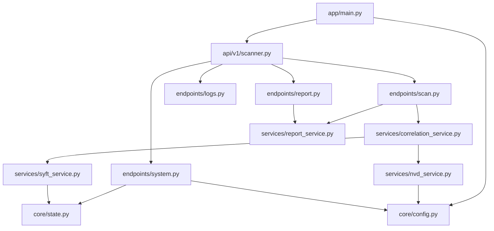

# Dependencies — Original Airlock

## External services and binaries

| Dependency | Used by | Notes |
|---|---|---|
| NVD CVE API 2.0 | NVDService | API key in `NVD_API_KEY`; 50 requests / 30 s with key, 5 / 30 s without |
| Anchore Syft v1.0.1 | SyftService | `SYFT_BINARY_PATH` (defaults to `syft`); copied from `anchore/syft:v1.0.1` in Docker; `scripts/install_tools.sh` locally |
| Google Fonts / Material Symbols | Frontend | Inter, JetBrains Mono, Material Symbols Outlined |
| DiceBear avatar API | Navbar | `https://api.dicebear.com/7.x/avataaars/svg?seed=Airlock` placeholder avatar |

## Internal module dependencies (backend)

Text alternative: `main.py` loads settings and mounts the router aggregator, which mounts the scan, system, logs and
report endpoint modules. The scan endpoint uses CorrelationService and ReportService; the report endpoint uses
ReportService. CorrelationService uses SyftService and NVDService. SyftService and the system endpoint share the
global scan state; NVDService and the system endpoint read settings.

## Python packages (`requirements.txt`, all pinned)

fastapi 0.135.2 · uvicorn[standard] 0.42.0 · pydantic 2.13.0b2 · pydantic-settings 2.13.1 · nvdlib 0.8.3 ·
httpx 0.28.1 · tenacity 9.1.4 · python-dotenv 1.2.2 · pytest 9.0.2 · pytest-asyncio 1.3.0 · anyio[trio] 4.13.0 ·
loguru 0.7.3 · sse-starlette 3.3.3 · fpdf2 2.8.7 · python-multipart 0.0.22. Test dependencies ship in the runtime image.

## npm packages (`web/package.json`)

- dependencies: react ^19.2.4, react-dom ^19.2.4, jspdf ^2.5.1, jspdf-autotable ^3.8.2
- devDependencies: @eslint/js, @types/react, @types/react-dom, @vitejs/plugin-react ^6.0.1, eslint ^9.39.4,
  eslint-plugin-react-hooks, eslint-plugin-react-refresh, globals, vite ^8.0.1, autoprefixer, postcss,
  tailwindcss ^3.4.4. `tailwindcss-animate` is **not** installed although its classes are used.

## Configuration (environment variables)

| Variable | Purpose | Read by |
|---|---|---|
| `NVD_API_KEY` | NVD API key | Settings → NVDService |
| `APP_NAME`, `APP_VERSION`, `DEBUG`, `API_V1_STR` | App metadata and route prefix | Settings |
| `SYFT_BINARY_PATH` | Syft location | SyftService (`os.getenv`) |
| `LOG_LEVEL` | Console log level | logger |
| `SCAN_UPLOAD_PATH` | Host folder mounted at `/uploads` | docker-compose |
| `AIRLOCK_API_EXTERNAL_PORT`, `AIRLOCK_API_INTERNAL_PORT` | Port mapping (documented, compose hard-codes 8000) | — |
| `VITE_API_BASE_URL` | Frontend → API base URL | Frontend |
| `ALLOWED_HOSTS` | CORS origins | Settings (ignored by `main.py`) |
